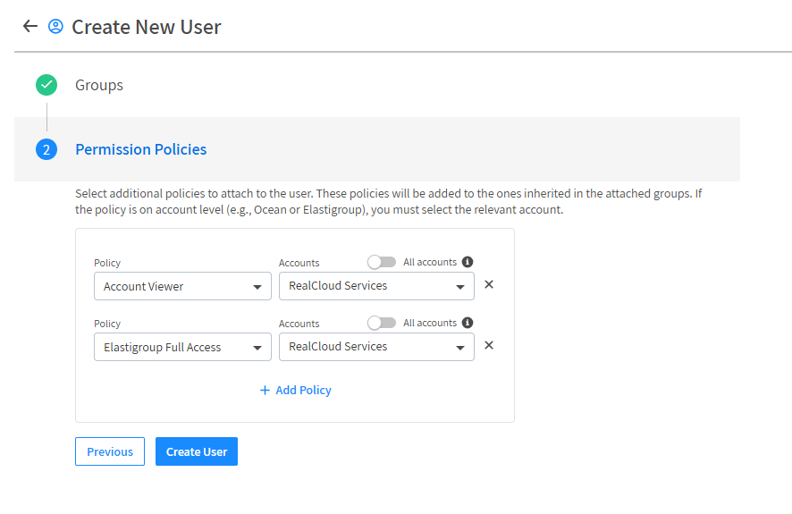
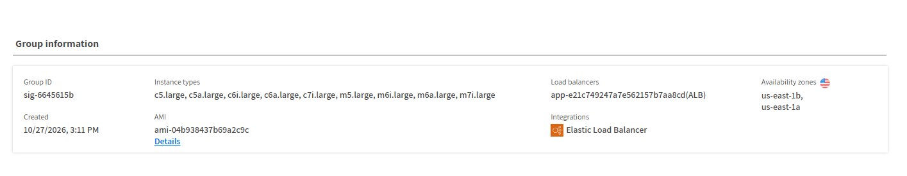
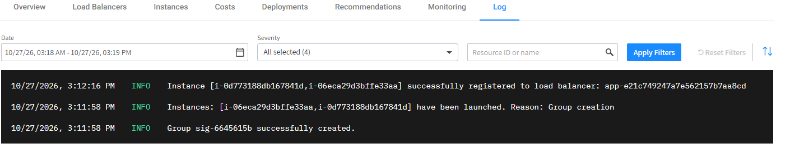
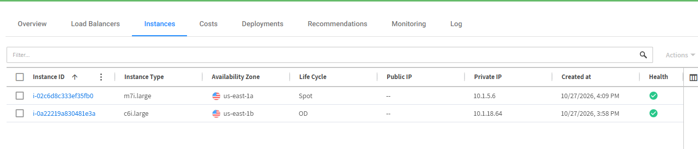
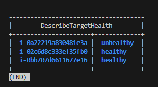
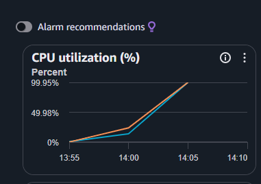
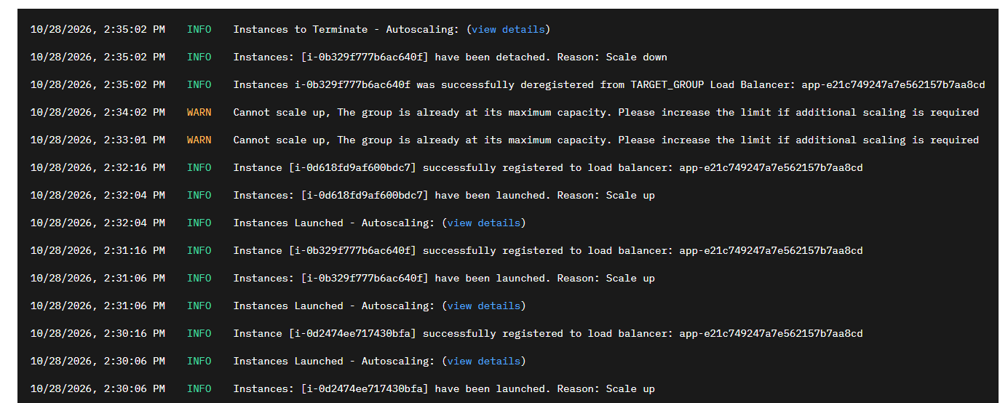
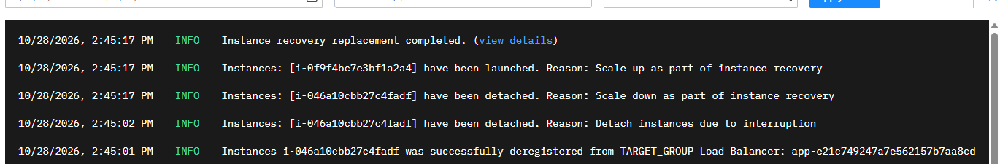
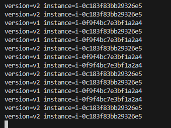
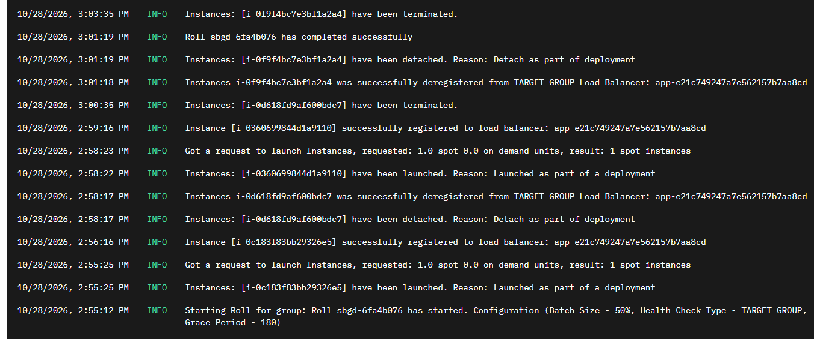

# Elastigroup Lab

Recomendamos a leitura desta [documentação](./about_elastic.md) para que você possa ter uma visão geral de como o Flexera Elastigroup funciona.

A seguir, você poderá executar este laboratório para ver na prática como criar um Elastigroup, e entender e testar as suas funcionalidades. O laboratório sobe um nginx em instâncias EC2 atrás de um Application Load Balancer, e cada instância responde com a versão da aplicação e com os dados de onde está rodando (tipo, zona e se é Spot ou On-Demand). Assim, um simples `curl` mostra o que o Elastigroup está fazendo.

## Arquitetura

```
Internet ──> ALB (subnets públicas) ──> Target Group ──> instâncias do Elastigroup (subnets privadas)
                                              ^                         |
                                              └── registro automático ──┘
```

- **Rede**: uma VPC própria (`10.1.0.0/16`) com subnets públicas e privadas em 2 zonas de disponibilidade e um único NAT Gateway, criada em [vpc.tf](./vpc.tf). O laboratório não depende de nenhum outro projeto do repositório.
- **ALB, Security Groups e IAM**: criados com os módulos [terraform-aws-modules](https://github.com/terraform-aws-modules) em [network.tf](./network.tf) e [iam.tf](./iam.tf). As instâncias só recebem tráfego do ALB e não têm SSH: o acesso é feito pelo SSM.
- **Elastigroup**: o recurso `spotinst_elastigroup_aws` em [elastigroup.tf](./elastigroup.tf). Não existe módulo da terraform-aws-modules para ele, já que é um recurso da Spot.

## Cenários

Cada cenário é um arquivo `.tfvars` dentro de [scenarios/](./scenarios/).

| # | Cenário | Arquivo | O que explora |
|---|---------|---------|---------------|
| 01 | [Configuração do Elastigroup](#configuração-do-elastigroup) | [01-baseline.tfvars](./scenarios/01-baseline.tfvars) | Grupo com 2 instâncias Spot, fallback para On-Demand e registro no ALB |
| 02 | [Explorando os mercados: Spot e On-Demand](#explorando-os-mercados-spot-e-on-demand) | [02-markets.tfvars](./scenarios/02-markets.tfvars) | Base fixa de On-Demand com `ondemand_count`, tipos Spot preferidos e um Roll pela API para aplicar a mudança (com uma explicação do `orientation`) |
| 03 | [Explorando o Auto Healing](#explorando-o-auto-healing) | [03-auto-healing.tfvars](./scenarios/03-auto-healing.tfvars) | Health check pelo Target Group e substituição de instâncias doentes |
| 04 | [Explorando o Scaling](#explorando-o-scaling) | [04-scaling.tfvars](./scenarios/04-scaling.tfvars) | Target tracking na CPU média do grupo, scale up e scale down |
| 05 | [Explorando as interrupções das máquinas Spot](#explorando-as-interrupções-das-máquinas-spot) | [05-spot-interruption.tfvars](./scenarios/05-spot-interruption.tfvars) | Interrupção de uma instância Spot com o AWS FIS e a reposição pelo Elastigroup |
| 06 | [Explorando o Roll - Deploy blue/green](#explorando-o-roll---deploy-bluegreen) | [06-roll.tfvars](./scenarios/06-roll.tfvars) | Nova versão da aplicação trocando as instâncias em lotes |
| 07 | [Explorando o Scheduling](#explorando-o-scheduling) | [07-scheduling.tfvars](./scenarios/07-scheduling.tfvars) | Tarefas com cron que desligam e religam o grupo |

Um cenário é aplicado gerando o plano com o arquivo do cenário e aplicando o plano:

```bash
terraform plan -out plan -var-file=scenarios/<cenário>.tfvars
terraform apply plan
```

> Os cenários **não são cumulativos**: cada arquivo altera somente alguns valores, e tudo o que ele não define volta para o padrão do [variables.tf](./variables.tf). Isso inclui a capacidade: todo apply volta o grupo para o `desired_capacity` de 2 instâncias, mesmo que uma política de escala ou uma tarefa agendada tenha alterado esse valor.

## Passo a Passo

### Dependências

As ferramentas (`terraform` e `aws`) são instaladas pelo [mise](https://mise.jdx.dev/) a partir do [mise.toml](../mise.toml) da raiz do repositório:

```bash
mise install
```

### Backend e profile

O state fica no bucket S3 definido no bloco `backend` do [versions.tf](./versions.tf), e o profile da AWS em [locals.tf](./locals.tf). Ajuste os dois caso esteja usando outro bucket ou outro profile.

> As instâncias rodam nas subnets privadas e usam o NAT Gateway para instalar o nginx e falar com o SSM. O ALB fica nas subnets públicas. Para manter o custo baixo, existe um único NAT Gateway, o que não é altamente disponível.

### Arquivo env

Copie o arquivo [.env.example](./.env.example) para `.env` e preencha as variáveis com os valores do próximo passo. O `.env` é carregado automaticamente pelo mise (pelo [mise.toml](./mise.toml) desta pasta, que precisa ser marcado como confiável uma vez) e não deve ser commitado:

```bash
cd elastic-lab
cp .env.example .env
mise trust
```

### Token e ID da Conta

O processo é o mesmo do [Ocean Lab](../ocean-lab/lab_ocean.md#criar-o-token-e-buscar-o-id-da-conta): o ID da conta (`act-...`) vai na env `TF_VAR_spotinst_account` e o token de um Programmatic User vai na env `TF_VAR_spotinst_token`.

A diferença está nas policies do usuário: o token do Ocean Lab tem somente "Account Viewer" e "Ocean Full Access", e **não consegue criar um Elastigroup**. Crie um novo Programmatic User com:
- "Account Viewer"
- "Elastigroup Full Access"

Ambas associadas à conta da AWS do laboratório (no exemplo abaixo, a conta se chama "RealCloud Services"; selecione a sua):



> As policies não podem ser editadas depois que o usuário é criado, por isso é necessário um novo usuário em vez de reaproveitar o do Ocean.

### Configuração do Elastigroup

Com as configurações acima feitas, execute o plan e o apply com o cenário [01-baseline.tfvars](./scenarios/01-baseline.tfvars), que não altera nenhum valor e usa somente os padrões do [variables.tf](./variables.tf):

```bash
terraform init
terraform plan -out plan -var-file=scenarios/01-baseline.tfvars
terraform apply plan
```

### Conceitos

**Elastigroup**

É o objeto principal, criado no SaaS da Spot (recurso `spotinst_elastigroup_aws`, ID com prefixo `sig-`). Ele faz o papel de um Auto Scaling Group e concentra:

- **Capacidade**: `min_size = 1`, `max_size = 4` e `desired_capacity = 2`. Com `capacity_unit = "instance"`, cada instância conta como uma unidade, independente do tipo.
- **Configuração de lançamento**: a AMI Amazon Linux 2023 mais recente (lida do SSM da AWS), o user data que instala o nginx, o instance profile com a policy do SSM, o security group e as subnets privadas, uma por zona de disponibilidade.
- **Tipos de instância**: uma lista de tipos Spot (`instance_types_spot`) e um tipo On-Demand (`instance_types_ondemand`). Todos os tipos da lista têm 2 vCPU, para que a aplicação se comporte da mesma forma em qualquer um deles.
- **Estratégia**: `spot_percentage = 100`, `fallback_to_ondemand = true` (usa On-Demand se não houver capacidade Spot) e `revert_to_spot = "always"` (volta para Spot assim que possível).
- **Load balancer**: o Target Group do ALB em `target_group_arns`. O Elastigroup registra cada instância nova e remove as que vão ser encerradas, respeitando o `draining_timeout` de 60 segundos.

> Assim como o Ocean, o Elastigroup **não cria um Auto Scaling Group nem um Launch Template** na AWS. As instâncias são lançadas diretamente pela role da Spot na sua conta, e aparecem no console do EC2 como instâncias comuns.

**Diversificação de tipos e zonas**

Em vez de lançar todas as instâncias no mesmo tipo, o Elastigroup distribui o grupo entre os tipos permitidos e as zonas de disponibilidade. Se a AWS retomar a capacidade Spot de um tipo em uma zona, somente parte do grupo é afetada. Quanto maior a lista de tipos, mais mercados Spot o Elastigroup tem para escolher, e menor o risco de interrupções.

**Tags**

O Elastigroup aplica as tags do bloco `tags` em todas as instâncias que lança. O laboratório usa a tag `elastic-lab/group = elastic-lab` para encontrar as instâncias nos comandos da AWS CLI, no SSM e no FIS.

> **Documentação do Elastigroup:** [Criar um Elastigroup](https://docs.flexera.com/spot/elastigroup/tutorials/elastigroup-tasks/create-an-elastigroup-from-scratch-nw) | [Visão geral dos grupos no console](https://docs.flexera.com/spot/elastigroup/tutorials/elastigroup-actions-menu/elastigroup-overview) | [Capacidade em instâncias ou ponderada](https://docs.flexera.com/spot/elastigroup/features/core-features/elastigroup-capacity-instances-or-weighted)

#### Validação

**Comandos de apoio**: o [mise.toml](./mise.toml) desta pasta tem tasks do mise usadas nos cenários. Elas leem a URL da aplicação, o ARN do Target Group e o template do FIS dos outputs do Terraform, e usam o `AWS_PROFILE` definido no próprio `mise.toml` (ajuste caso use outro profile, junto com o [locals.tf](./locals.tf)):

| Task | O que faz |
|------|-----------|
| `mise run instances` | Instâncias do grupo: ID, tipo, Spot ou On-Demand, zona e estado |
| `mise run targets` | Saúde das instâncias no Target Group do ALB |
| `mise run hits` | 10 requisições para a aplicação |
| `mise run status` | Código HTTP de uma requisição para a aplicação |
| `mise run watch-status` | Uma requisição por segundo, mostrando somente o código HTTP |
| `mise run watch-version` | Uma requisição por segundo, mostrando a versão da aplicação e a instância |
| `mise run stop-nginx [id]` | Para o nginx de uma instância pelo SSM ([Auto Healing](#explorando-o-auto-healing)) |
| `mise run cpu-load` | Gera 100% de CPU nas instâncias por 15 minutos pelo SSM ([Scaling](#explorando-o-scaling)) |
| `mise run roll [--batch 50]` | Inicia um Roll do grupo pela API da Spot ([Mercados](#explorando-os-mercados-spot-e-on-demand)) |
| `mise run roll-status` | Status e progresso dos últimos Rolls do grupo |
| `mise run schedule` | Tarefas agendadas do grupo e a capacidade atual ([Scheduling](#explorando-o-scheduling)) |
| `mise run fis-start` | Inicia o experimento do FIS ([Interrupções Spot](#explorando-as-interrupções-das-máquinas-spot)) |
| `mise run fis-status` | Status do último experimento do FIS |

Para listar as tasks: `mise tasks`.

1. **Instâncias**: cerca de 1 minuto após o apply, o grupo tem 2 instâncias Spot, normalmente de tipos e zonas diferentes.

   ```bash
   mise run instances
   ```

2. **Load balancer**: depois que o nginx é instalado (1 a 2 minutos), as 2 instâncias ficam `healthy` no Target Group, e as requisições se alternam entre elas:

   ```bash
   mise run targets
   mise run hits
   ```

   ```
   version=v1 instance=i-0a1... type=c6a.large az=us-east-1a lifecycle=spot
   version=v1 instance=i-0b2... type=m5.large az=us-east-1b lifecycle=spot
   ```

**No Console AWS**: no EC2, as instâncias aparecem com o nome `elastic-lab-app`, com o tipo de ciclo de vida "Spot" e sem nenhum Auto Scaling Group. No Target Group `app-...`, as instâncias foram registradas pelo Elastigroup, e não pelo Terraform.

**No Console Spot**: clique nos quadradinhos no canto superior esquerdo > selecione o produto **Elastigroup**, e na listagem de grupos selecione o `elastic-lab`. O grupo tem as abas **Overview**, **Load Balancers**, **Instances**, **Costs**, **Deployments**, **Recommendations**, **Monitoring** e **Log**.

Na **Overview**, a seção **Group information** resume a configuração do grupo:



> O ID `sig-`, a lista de tipos Spot do `instance_types_spot`, a AMI lida do SSM, o ALB em **Load balancers** (a integração aparece como "Elastic Load Balancer") e as 2 zonas de disponibilidade das subnets privadas. Os IDs serão os do seu ambiente.

A aba **Log** registra cada ação do grupo. Logo após o apply, ela mostra a criação do grupo, o lançamento das 2 instâncias e o registro delas no Target Group:



> Lendo de baixo para cima: o grupo é criado, as 2 instâncias são lançadas com o motivo `Group creation` e, cerca de 20 segundos depois, registradas no Target Group `app-...`. Os horários são mostrados no fuso do seu navegador.

### Explorando os mercados: Spot e On-Demand

No baseline, todas as instâncias são Spot e o On-Demand só é usado como fallback. Neste cenário vamos manter uma **base garantida de On-Demand** e influenciar quais tipos Spot o Elastigroup escolhe.

#### Como funciona

O Elastigroup oferece duas formas de misturar os mercados:

- **`spot_percentage`**: o percentual de instâncias Spot do grupo. Com 50%, metade é Spot e metade On-Demand, e a proporção acompanha o tamanho do grupo.
- **`ondemand_count`**: uma quantidade fixa de instâncias On-Demand, e o restante Spot. É útil para ter um mínimo de capacidade que nunca sofre interrupções, independente do tamanho do grupo. Quando definido, ele substitui o `spot_percentage` (a Spot não aceita os dois ao mesmo tempo, então o laboratório envia somente um deles).

E duas formas de influenciar a escolha das instâncias Spot:

- **`instance_types_preferred_spot`**: tipos que o Elastigroup tenta usar primeiro, desde que o mercado esteja saudável. Os demais tipos de `instance_types_spot` continuam disponíveis como alternativa.
- **`orientation`**: a estratégia de escolha dos mercados, descrita abaixo.

##### Orientation: a estratégia de escolha dos mercados

Para cada instância Spot, o Elastigroup escolhe um **mercado**: a combinação de um tipo de instância com uma zona de disponibilidade. O `orientation` (no console da Spot, **Cluster Orientation**) define o que pesa mais nessa escolha:

| Valor | Prioriza | Quando usar |
|-------|----------|-------------|
| `balanced` (padrão do laboratório) | Equilíbrio entre preço e risco de interrupção | A maioria dos workloads stateless |
| `costOriented` | Os mercados mais baratos, mesmo com um risco de interrupção maior | Workloads que toleram bem as interrupções, como batch e CI |
| `availabilityOriented` | Os mercados com menor risco de interrupção, mesmo que mais caros | Workloads mais sensíveis à troca de instâncias |
| `equalAzDistribution` | A mesma quantidade de instâncias em cada zona de disponibilidade | Quando a distribuição entre zonas importa mais do que o preço |

Para testar um valor no laboratório, defina-o no bloco `elastigroup` de um arquivo de cenário, por exemplo `orientation = "costOriented"`. Como o `ondemand_count`, ele vale somente para **novos lançamentos**: depois do apply, use `mise run roll` para trocar as instâncias que já existem.

> Este laboratório não tem um cenário para o `orientation`. O efeito dele depende do preço e do risco de cada mercado no momento, e com um grupo pequeno, de 2 instâncias e tipos do mesmo tamanho, valores diferentes podem escolher os mesmos tipos. A diferença aparece em grupos maiores, com uma lista grande de tipos.

O arquivo [02-markets.tfvars](./scenarios/02-markets.tfvars) configura:

```hcl
elastigroup = {
  ondemand_count                = 1                            # sempre 1 instância On-Demand
  instance_types_preferred_spot = ["c7i.large", "m7i.large"]   # Spot de geração mais nova primeiro
}
```

> **Atenção:** a mudança de mercados vale somente para **novos lançamentos** (scale up e substituições). O Elastigroup não converte uma instância Spot que já está rodando em On-Demand: sem um Roll, o grupo continuaria somente com Spot até alguma instância ser substituída. Por isso, depois do apply, o cenário inicia um Roll pela API da Spot com a task `mise run roll` (lotes de 50%, validados pelo Target Group). O Roll é explicado em detalhes no [cenário 06](#explorando-o-roll---deploy-bluegreen).

> Ligar o `should_roll` no Terraform não resolve aqui: o `update_policy` não faz parte da configuração do grupo na API da Spot, e o provider só inicia um Roll quando o mesmo apply também altera o grupo. Se os mercados já tiverem sido aplicados antes, o apply não muda nada no grupo, e nenhum Roll acontece.

Aplique o cenário e inicie o Roll:

```bash
terraform plan -out plan -var-file=scenarios/02-markets.tfvars
terraform apply plan
mise run roll
```

#### Validação

1. **Base On-Demand**: o Roll troca as instâncias em 2 lotes, e o andamento pode ser acompanhado com `mise run roll-status`. Ao final, o grupo tem 1 instância On-Demand do tipo `c6i.large` (o `instance_types_ondemand`) e 1 Spot.

   ```bash
   mise run instances
   mise run hits
   ```

   O `mise run hits` passa a mostrar respostas com `lifecycle=spot` e `lifecycle=on-demand`. O andamento do Roll aparece na aba **Deployments** do grupo.

2. **Tipos preferidos**: a instância Spot deve ser `c7i.large` ou `m7i.large`, se houver capacidade Spot nesses tipos. Caso contrário, o Elastigroup usa outro tipo da lista.

   Os tipos preferidos, ao contrário da base On-Demand, são aplicados sem o Roll: a aba **Log** registra uma substituição com o motivo `Spot Type Preference`, em que o Elastigroup sobe uma instância Spot de um tipo preferido e depois remove uma de outro tipo. Durante essa troca, o grupo fica temporariamente com uma instância a mais.

3. **Console**: na aba **Instances**, a coluna **Life Cycle** mostra a divisão entre Spot e On-Demand (`OD`):

   

   > A instância On-Demand é do tipo `c6i.large` (o `instance_types_ondemand`), e a Spot é uma `m7i.large`, um dos tipos preferidos, lançada depois pela substituição `Spot Type Preference`. As duas aparecem saudáveis na coluna **Health**. Os IDs, as zonas e os horários serão os do seu ambiente.

   Na aba **Costs**, confira a economia estimada, que diminui com a instância On-Demand.

> **Documentação do Elastigroup:** [Compute](https://docs.flexera.com/spot/elastigroup/features/compute), com os mercados, tipos de instância e estratégias

#### Custo x Benefício

Cada instância On-Demand custa várias vezes o preço de uma Spot do mesmo tamanho. Uma base On-Demand faz sentido quando a aplicação não pode ficar sem nenhuma instância durante uma interrupção, mesmo que por poucos minutos. Para a maioria dos workloads stateless, uma lista grande de tipos Spot e várias zonas de disponibilidade já dão uma disponibilidade alta, com o fallback para On-Demand como rede de segurança.

### Explorando o Auto Healing

No baseline, o health check é o status do EC2 (`health_check_type = "EC2"`): o Elastigroup só substitui uma instância se a própria máquina falhar. Se o nginx parar, o ALB deixa de mandar tráfego para a instância, mas ela continua rodando e sendo cobrada. Neste cenário, o **Target Group** passa a decidir quando uma instância está doente.

#### Como funciona

Três configurações controlam o auto healing:

- **`health_check_type`**: a origem da informação de saúde. `EC2` usa os status checks da instância; `TARGET_GROUP` usa o health check do Target Group do ALB, que aqui faz um `GET /` a cada 10 segundos.
- **`health_check_grace_period`**: o tempo, após o lançamento, em que o health check é ignorado. Ele dá tempo para a instância subir e instalar o nginx.
- **`health_check_unhealthy_duration_before_replacement`**: quanto tempo a instância pode ficar doente antes de ser substituída. Ele só vale para instâncias que já foram saudáveis pelo menos uma vez.

O arquivo [03-auto-healing.tfvars](./scenarios/03-auto-healing.tfvars) configura:

```hcl
elastigroup = {
  health_check_type                                  = "TARGET_GROUP"
  health_check_grace_period                          = 120 # segundos
  health_check_unhealthy_duration_before_replacement = 60  # segundos
}
```

A substituição segue o modelo blue/green: o Elastigroup sobe uma nova instância, espera ela ficar saudável no Target Group, e só então encerra a doente.

Aplique o cenário:

```bash
terraform plan -out plan -var-file=scenarios/03-auto-healing.tfvars
terraform apply plan
```

#### Validação

1. **Quebre uma instância**: pare o nginx de uma das instâncias pelo SSM Run Command. Sem um ID, a task escolhe a primeira instância em execução e mostra qual foi.

   ```bash
   mise run instances
   mise run stop-nginx            # ou: mise run stop-nginx <id da instância>
   ```

2. **Acompanhe o Target Group e as instâncias**: em outro terminal, repita as tasks abaixo.

   ```bash
   mise run targets
   mise run instances
   mise run hits
   ```

   A sequência esperada é:

   1. Cerca de 20 segundos depois, a instância fica `unhealthy` no Target Group (2 falhas a cada 10 segundos), e o `mise run hits` passa a mostrar somente a outra instância.
   2. Depois do `health_check_unhealthy_duration_before_replacement`, o Elastigroup lança uma instância nova, que aparece como `initial` e depois `healthy` no Target Group.
   3. A instância doente passa para `draining` e é encerrada.

   Durante a substituição, o Target Group tem 3 instâncias por alguns instantes: a doente e as 2 saudáveis, incluindo a nova.

   

   > Neste exemplo, o nginx foi parado na instância On-Demand do cenário anterior (`i-0a22...`). A substituta (`i-0bb7...`) já está `healthy`, e a doente será encerrada em seguida. Os IDs serão os do seu ambiente.

3. **Console**: a aba **Log** do grupo registra a instância marcada como doente e a substituição.

> Para comparar, repita o teste com o baseline aplicado: o ALB tira a instância do tráfego da mesma forma, mas o Elastigroup nunca a substitui, já que para o EC2 a máquina continua saudável.

> **Documentação do Elastigroup:** [Autohealing](https://docs.flexera.com/spot/elastigroup/features/compute/autohealing) | [Load Balancers da AWS e Autohealing](https://docs.flexera.com/spot/elastigroup/tools-integrations/aws-load-balancers-elb-alb)

#### Custo x Benefício

Um `unhealthy_duration` curto troca as instâncias doentes mais rápido, mas pode substituir instâncias que só estavam lentas por alguns segundos, por exemplo durante um pico de carga. Um `grace_period` curto demais faz o Elastigroup substituir instâncias que ainda estavam subindo, em um ciclo que nunca termina. Ajuste os dois de acordo com o tempo real de inicialização da aplicação.

### Explorando o Scaling

Até aqui, o grupo teve sempre 2 instâncias. Neste cenário o Elastigroup passa a **ajustar a capacidade de acordo com a carga**, usando uma política de *target tracking* na CPU.

#### Como funciona

O Elastigroup suporta os mesmos tipos de políticas de um Auto Scaling Group:

- **Simple e step scaling**: adicionam ou removem instâncias quando uma métrica ultrapassa um limite.
- **Target tracking**: mantém uma métrica perto de um valor alvo. O Elastigroup calcula quantas instâncias são necessárias e escala para cima ou para baixo, dentro do `min_size` e do `max_size`.
- **Predictive autoscaling**: uma extensão do target tracking de CPU que usa machine learning para prever a carga e escalar com antecedência (não explorado neste laboratório).

O arquivo [04-scaling.tfvars](./scenarios/04-scaling.tfvars) configura:

```hcl
elastigroup = {
  enable_monitoring = true # métricas do CloudWatch a cada 1 minuto, em vez de 5
  scaling_target = {
    target   = 50 # CPU média do grupo em 50%
    cooldown = 60 # segundos entre duas ações de escala
  }
}
```

A política é criada em [elastigroup.tf](./elastigroup.tf) com a métrica `CPUUtilization` do namespace `AWS/EC2`, na média de todas as instâncias do grupo.

> O `enable_monitoring` liga o monitoramento detalhado do EC2, que tem um pequeno custo por instância. Sem ele, o CloudWatch recebe um ponto da métrica a cada 5 minutos, com alguns minutos de atraso, e a política tem poucos pontos para avaliar durante a carga.

> **Atenção:** assim como a base On-Demand do [cenário 02](#explorando-os-mercados-spot-e-on-demand), o `enable_monitoring` é uma configuração de lançamento e vale somente para **novas instâncias**. As instâncias que já estão rodando continuam com o monitoramento básico (confira com `Monitoring.State = disabled` no `aws ec2 describe-instances`). Sem o Roll, a carga do próximo passo pode terminar sem que o Elastigroup escale.
>
> 
>
> Na aba **Monitoring** do EC2, o gráfico de CPU de instâncias com o monitoramento básico tem um ponto a cada 5 minutos. Neste exemplo, a carga começou logo após as 14:00 (horário local), e a CPU chegou a 100% somente no ponto das 14:05. Os 10 minutos de carga terminaram sem nenhuma ação de escala no grupo.

Aplique o cenário, inicie o Roll e espere ele terminar (`finished`) antes de gerar a carga:

```bash
terraform plan -out plan -var-file=scenarios/04-scaling.tfvars
terraform apply plan
mise run roll
mise run roll-status
```

#### Validação

1. **Gere carga**: a task `cpu-load` envia pelo SSM, para as instâncias do grupo, o script [cpu-load.json](./scripts/cpu-load.json), que ocupa 100% de todos os vCPUs por 15 minutos:

   ```bash
   mise run cpu-load
   ```

2. **Scale up**: com as 2 instâncias em 100%, a CPU média fica bem acima dos 50%. Depois de alguns minutos (o tempo de a métrica chegar ao CloudWatch e de a política avaliar), o Elastigroup lança novas instâncias, uma por vez, até o `max_size` de 4.

   ```bash
   mise run instances
   ```

   As instâncias novas não recebem a carga, já que o comando foi enviado somente para as que existiam. Por isso, a média do grupo cai a cada instância nova, e o grupo oscila perto do alvo: ele pode remover uma instância e subir outra enquanto a carga continua.

3. **Scale down**: após os 15 minutos do script, a CPU cai, e o Elastigroup remove instâncias aos poucos até o `min_size` de 1. As instâncias removidas passam por `draining` no Target Group antes de serem encerradas.

4. **Console**: as ações de escala aparecem na aba **Log**:

   

   > Lendo de baixo para cima: 3 scale ups, com cerca de 1 minuto entre eles (o `cooldown` de 60 segundos), cada um com a instância nova registrada no Target Group. Em seguida, os avisos `Cannot scale up, The group is already at its maximum capacity` mostram que a política ainda queria mais instâncias, mas o grupo chegou ao `max_size`. Por fim, ainda durante a carga, um scale down remove uma das instâncias novas, já que elas não recebem carga e a média do grupo ficou abaixo do alvo. Os IDs e os horários serão os do seu ambiente.

> O próximo apply, de qualquer cenário, volta o grupo para 2 instâncias (o `desired_capacity` do [variables.tf](./variables.tf)).

> **Documentação do Elastigroup:** [Target scaling e Predictive Autoscaling](https://docs.flexera.com/spot/elastigroup/features/scaling/target-scaling) | [Simple scaling](https://docs.flexera.com/spot/elastigroup/features/scaling/simple-scaling-policies) | [Predictive Autoscaling](https://docs.flexera.com/spot/elastigroup/features/scaling/predictive-autoscaling)

#### Custo x Benefício

Um alvo de CPU baixo deixa mais folga para picos, mas mantém mais instâncias ligadas. Um alvo alto economiza, mas deixa a aplicação mais perto do limite enquanto as novas instâncias sobem. Como o Elastigroup usa Spot, escalar para cima custa bem menos do que em um ASG On-Demand, o que permite alvos mais conservadores.

### Explorando as interrupções das máquinas Spot

A AWS pode **retomar uma instância Spot** a qualquer momento, avisando com 2 minutos de antecedência. Neste cenário vamos provocar essa interrupção e ver como o Elastigroup reage.

#### Como funciona

O Elastigroup tenta evitar as interrupções: ele acompanha o histórico dos mercados Spot e substitui instâncias com risco alto **antes** que a AWS as retome. Quando a interrupção acontece mesmo assim, ele recebe o aviso, tira a instância interrompida do Target Group, para que o ALB pare de mandar tráfego para ela antes de ela desaparecer, e lança uma instância substituta (em outro mercado Spot ou, se não houver, On-Demand).

Para provocar a interrupção usamos o **AWS Fault Injection Service (FIS)**, como no [Ocean Lab](../ocean-lab/lab_ocean.md#explorando-as-interrupções-das-máquinas-spot). A ação `aws:ec2:send-spot-instance-interruptions` envia para uma instância o mesmo aviso de uma interrupção real.

O arquivo [05-spot-interruption.tfvars](./scenarios/05-spot-interruption.tfvars) configura:

```hcl
fis = {
  enabled = true # cria a role e o experimento do FIS
}
```

O [fis.tf](./fis.tf) cria uma role que só pode enviar avisos de interrupção, e um *experiment template* que seleciona **somente uma** instância Spot (`COUNT(1)`) com a tag `elastic-lab/group = elastic-lab`.

Aplique o cenário e confira que o grupo tem 2 instâncias Spot saudáveis:

```bash
terraform plan -out plan -var-file=scenarios/05-spot-interruption.tfvars
terraform apply plan
mise run instances
mise run targets
```

#### Validação

1. **Deixe as requisições rodando** em um terminal, para ver se alguma falha durante a interrupção:

   ```bash
   mise run watch-status
   ```

2. **Inicie o experimento** com o template do output do Terraform, e acompanhe o status (`initiating`, `running` e `completed`) do último experimento:

   ```bash
   mise run fis-start
   mise run fis-status
   ```

3. **Acompanhe as instâncias e o Target Group**:

   ```bash
   mise run instances
   mise run targets
   ```

   A sequência esperada é:

   1. Segundos após o aviso, o Elastigroup tira a instância interrompida do Target Group (ela passa para `draining`) e a desanexa do grupo.
   2. Cerca de 15 segundos depois, ele lança a instância substituta, como uma recuperação da instância (*instance recovery*).
   3. Ao final dos 2 minutos, a AWS encerra a instância interrompida. A substituta fica `healthy` depois que o nginx é instalado.

   Durante todo o processo, as requisições devem continuar respondendo `200`: enquanto a substituta sobe, a outra instância atende sozinha, e a interrompida já saiu do ALB antes de ser encerrada.

4. **Console**: a aba **Log** do grupo registra a interrupção e a recuperação da instância:

   

   > Lendo de baixo para cima: a instância interrompida é removida do Target Group e desanexada do grupo com o motivo `Detach instances due to interruption`. Cerca de 15 segundos depois, o Elastigroup faz a recuperação: a instância interrompida sai do grupo (`Scale down as part of instance recovery`), a substituta é lançada (`Scale up as part of instance recovery`), e a recuperação é concluída. Os IDs e os horários serão os do seu ambiente.

> **Documentação:** [Compute](https://docs.flexera.com/spot/elastigroup/features/compute), com a substituição das instâncias Spot | [Ações do AWS FIS](https://docs.aws.amazon.com/fis/latest/userguide/fis-actions-reference.html)

#### Custo x Benefício

Uma interrupção não derruba a aplicação quando ela tem mais de uma instância, em zonas diferentes, atrás de um load balancer. Com uma única instância, a aplicação ficaria fora do ar entre o encerramento e a subida da substituta. Por isso, para usar Spot com segurança, mantenha pelo menos 2 instâncias e uma lista grande de tipos.

### Explorando o Roll - Deploy blue/green

Mudanças na configuração de lançamento, como uma nova AMI ou um novo user data, valem somente para **novas instâncias**. Neste cenário vamos publicar uma nova versão da aplicação e usar o **Roll** do Elastigroup para trocar todas as instâncias existentes.

#### Como funciona

Um Roll troca as instâncias **em lotes**, no modelo blue/green: para cada lote, o Elastigroup sobe instâncias novas com a configuração atual, espera elas ficarem saudáveis e só então encerra as antigas. Se mais da metade das instâncias de um lote não ficar saudável no tempo de `grace_period`, o deploy falha e o Elastigroup para, sem trocar os lotes seguintes.

Os parâmetros ficam no bloco `update_policy` do [elastigroup.tf](./elastigroup.tf):

- **`should_roll`**: quando `true`, o apply do Terraform inicia um Roll depois de atualizar o grupo.
- **`batch_size_percentage`**: o percentual de instâncias trocado em cada lote.
- **`grace_period`**: quanto tempo o Elastigroup espera as instâncias novas ficarem saudáveis.
- **`health_check_type`**: o health check usado para validar cada lote, aqui o Target Group.
- **`strategy.action`**: `REPLACE_SERVER` sobe instâncias novas; `RESTART_SERVER` reinicia as existentes.

O arquivo [06-roll.tfvars](./scenarios/06-roll.tfvars) configura:

```hcl
app = {
  version = "v2" # muda o user data
}

elastigroup = {
  roll = {
    batch_size_percentage = 50  # 1 das 2 instâncias por vez
    grace_period          = 180 # segundos
    health_check_type     = "TARGET_GROUP"
  }
}
```

#### Validação

1. **Deixe as requisições rodando** em um terminal, mostrando a versão de cada resposta:

   ```bash
   mise run watch-version
   ```

2. **Gere o plano e aplique o cenário**: o plano mostra a alteração do `user_data`, e o Roll começa ao final do apply.

   > Aqui não é preciso o `mise run roll` do [cenário 02](#explorando-os-mercados-spot-e-on-demand): o provider inicia o Roll logo depois de atualizar o grupo, e a troca da versão altera o `user_data` no mesmo apply. Se o plano não mostrar a alteração do `user_data` (por exemplo, ao aplicar o cenário uma segunda vez, com o grupo já na `v2`), o apply não atualiza o grupo e nenhum Roll acontece. Nesse caso, use `mise run roll`.

   ```bash
   terraform plan -out plan -var-file=scenarios/06-roll.tfvars
   terraform apply plan
   ```

3. **Acompanhe a troca**: com 2 instâncias e lotes de 50%, são 2 lotes. Nas requisições, as respostas `version=v1` vão dando lugar a `version=v2`, com as duas versões convivendo durante o Roll, sem nenhuma falha.

   ```bash
   mise run instances
   mise run targets
   ```

   

   > Durante o primeiro lote, o ALB distribui as requisições entre a instância nova, já com a `v2`, e a instância antiga do segundo lote, ainda com a `v1`. No segundo lote, ela também é trocada, e todas as respostas passam a ser `v2`.

4. **Console**: a aba **Deployments** do grupo mostra o Roll, os lotes e o status de cada um, com o horário de início e de término. A aba **Log** registra cada passo dos lotes:

   

   > Lendo de baixo para cima: o Roll começa com a configuração do `roll_config` (lotes de 50%, health check pelo `TARGET_GROUP` e `grace_period` de 180 segundos). Em cada lote, o Elastigroup primeiro lança a instância nova (`Launched as part of a deployment`) e a registra no Target Group, e só cerca de 3 minutos depois, com o `grace_period`, desanexa e encerra a antiga (`Detach as part of deployment`). As instâncias novas mantêm o mercado das antigas (`requested: 1.0 spot`). Com 2 lotes, o Roll terminou em cerca de 6 minutos. Os IDs e os horários serão os do seu ambiente.

> Ao voltar para outro cenário, a versão volta para `v1` e o Roll fica desligado: as instâncias que já existem continuam com a `v2`, e somente as novas sobem com a `v1`. É o comportamento padrão sem Roll, e um bom exemplo de por que ele é necessário.

> **Documentação do Elastigroup:** [Visão geral dos grupos e a aba Deployments](https://docs.flexera.com/spot/elastigroup/tutorials/elastigroup-actions-menu/elastigroup-overview)

#### Custo x Benefício

Durante o Roll, as instâncias antigas e novas rodam ao mesmo tempo, e o custo sobe temporariamente. Em troca, a nova versão chega a todas as instâncias sem indisponibilidade e com uma validação de saúde a cada lote. Lotes menores deixam o deploy mais lento e mais seguro.

### Explorando o Scheduling

Ambientes de desenvolvimento e testes raramente precisam ficar ligados 24 horas por dia. O Elastigroup permite **agendar tarefas** no grupo com expressões cron, sem depender de scripts ou automações externas.

#### Como funciona

O bloco `scheduled_task` aceita alguns tipos de tarefa (`task_type`):

- **`scale`**: altera a capacidade do grupo (`scale_target_capacity`, `scale_min_capacity` e `scale_max_capacity`).
- **`roll`**: executa um Roll, com o `batch_size_percentage` da tarefa.
- **`backup_ami`**: cria uma AMI a partir de uma instância do grupo.

Os horários do cron são em **UTC**.

O arquivo [07-scheduling.tfvars](./scenarios/07-scheduling.tfvars) configura duas tarefas:

```hcl
elastigroup = {
  scheduled_tasks = [
    {
      task_type             = "scale"
      cron_expression       = "0 19 * * *"  # todos os dias às 19:00 UTC: desliga
      scale_target_capacity = 0
      scale_min_capacity    = 0
      scale_max_capacity    = 4
    },
    {
      task_type             = "scale"
      cron_expression       = "0 21 * * *"  # todos os dias às 21:00 UTC: religa, 2 horas depois
      scale_target_capacity = 2
      scale_min_capacity    = 1
      scale_max_capacity    = 4
    },
  ]
}
```

> **Atenção:** os horários do arquivo são só um exemplo. Para ver o resultado, **edite os dois crons**: a tarefa de desligar para poucos minutos à frente do horário atual em UTC (`date -u`), e a de religar para pelo menos 2 horas depois dela.

> A tarefa de desligar precisa alterar também o `scale_min_capacity`, já que o grupo não pode ficar abaixo do mínimo. A de religar volta o mínimo para 1.

#### Preparação

```bash
date -u
terraform plan -out plan -var-file=scenarios/07-scheduling.tfvars
terraform apply plan
```

#### Validação

1. **Configuração**: confira as tarefas pela API da Spot, junto com a capacidade atual do grupo:

   ```bash
   mise run schedule
   ```

   ```
   0 21 * * *	scale	target=2 min=1 max=4	enabled=true
   0 19 * * *	scale	target=0 min=0 max=4	enabled=true
   capacity now: target=2 min=1 max=4
   ```

   > Diferente do Ocean, que mostra as janelas de shutdown em uma grade semanal, o console do Elastigroup não tem uma tela para as tarefas agendadas: elas não aparecem na edição do grupo, somente no JSON da configuração do grupo (no bloco `scheduling.tasks`). Os crons ficam sempre em UTC.

2. **Desligamento**: no horário da primeira tarefa, o Elastigroup remove todas as instâncias. O Target Group fica vazio e o ALB passa a responder `503`.

   ```bash
   mise run instances
   mise run status
   ```

3. **Religamento**: no horário da segunda tarefa, o grupo volta para 2 instâncias, e a aplicação volta a responder depois que o nginx sobe.

> Um apply feito entre as duas tarefas volta o grupo para os valores do Terraform (2 instâncias, mínimo de 1), religando o grupo antes da hora.

#### Custo x Benefício

Desligar um ambiente de dev das 19h às 7h e nos fins de semana corta cerca de 64% das horas da semana. A diferença para o shutdown hours do Ocean é que aqui o desligamento é feito com duas tarefas de escala, e você controla a capacidade de cada uma: por exemplo, reduzir para 1 instância à noite em vez de desligar.

## Limpeza

Ao terminar, destrua o laboratório. O Elastigroup encerra as instâncias ao ser removido:

```bash
terraform plan -destroy -out plan
terraform apply plan
```

A VPC e o NAT Gateway são removidos junto com o restante do laboratório.
