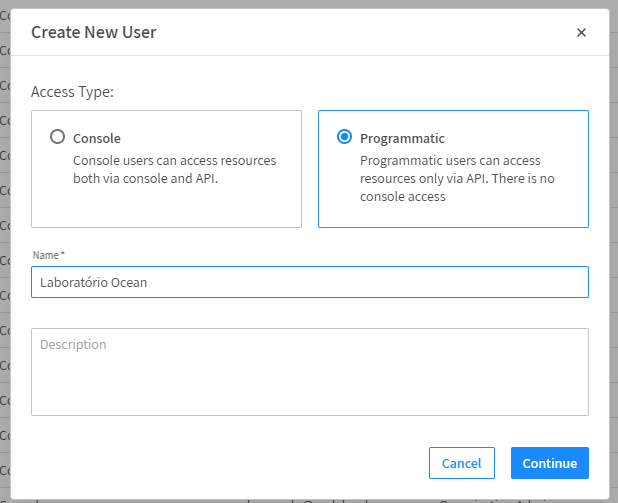
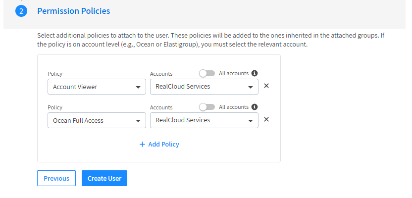
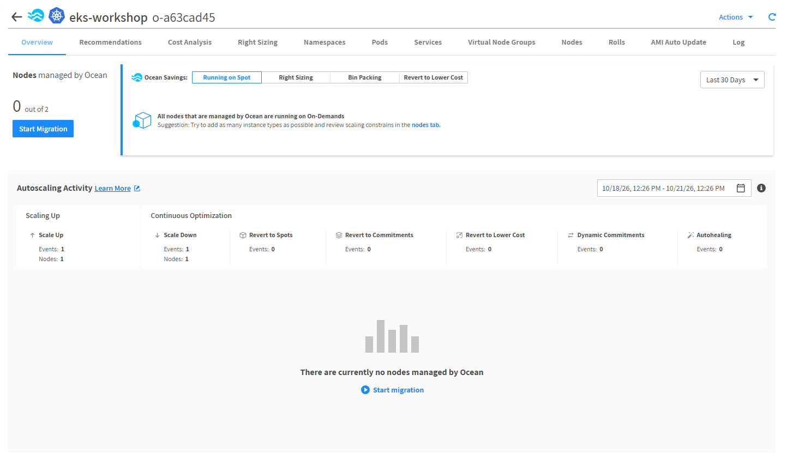
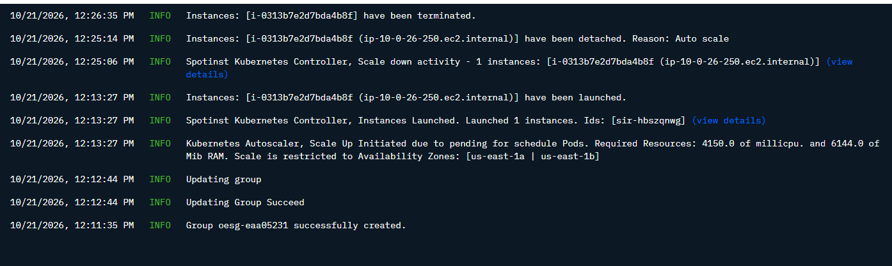
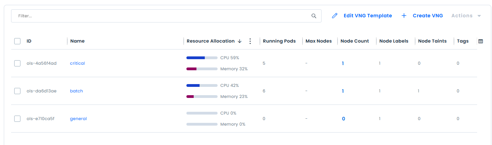
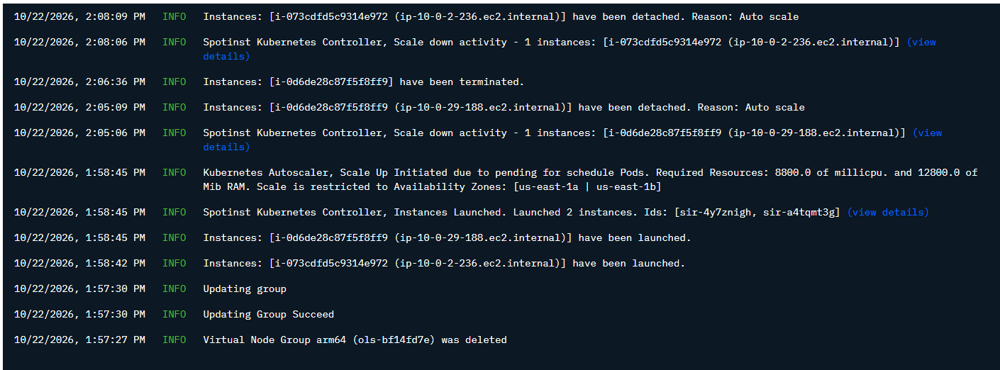
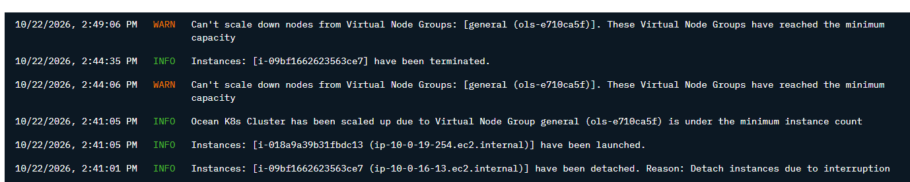
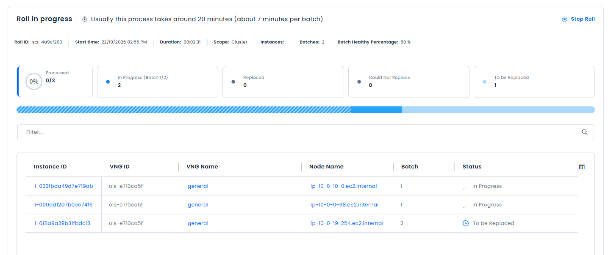
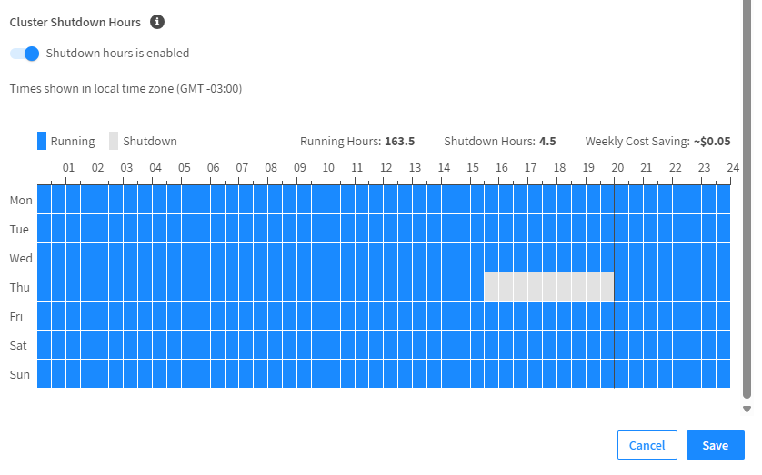
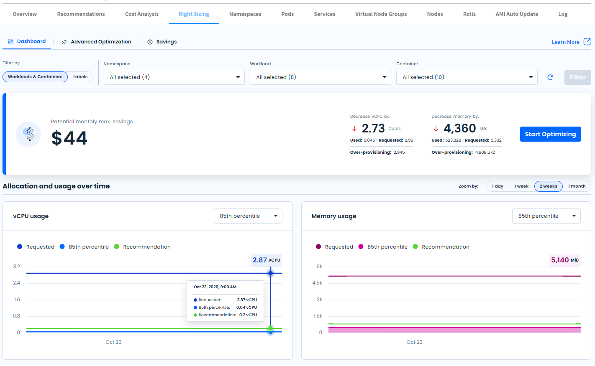

# Ocean Lab

Recomendamos a leitura desta [documentação](./about_ocean.md) para que você possa ter uma visão geral de como o Flexera Ocean funciona.

A seguir, você poderá executar este laboratório para ver na prática como configurar o Ocean em seu cluster, e entender e testar as suas funcionalidades.

## Cenários

Cada cenário é um arquivo `.tfvars` dentro de [scenarios/](./scenarios/), e os workloads de teste ficam em [workloads/](./workloads/).

| # | Cenário | Arquivo | O que explora |
|---|---------|---------|---------------|
| 01 | [Configuração do Ocean](#configuração-do-ocean) | [01-baseline.tfvars](./scenarios/01-baseline.tfvars) | Ocean Cluster, VNG `general`, Controller, scale up e scale down |
| 02 | [Explorando o Headroom](#explorando-o-headroom) | [02-headroom.tfvars](./scenarios/02-headroom.tfvars) | Headroom automático + manual |
| 03 | [Explorando os Virtual Node Groups](#explorando-os-virtual-node-groups) | [03-vngs.tfvars](./scenarios/03-vngs.tfvars) | Isolamento de workloads com labels, taints e On-Demand |
| 04 | [Explorando tipos de instâncias](#explorando-tipos-de-instâncias) | [04-instances.tfvars](./scenarios/04-instances.tfvars) | Filtros de instâncias, `availability_vs_cost` e ARM (Graviton) |
| 05 | [Explorando o Scale Down](#explorando-o-scale-down) | [05-scale-down.tfvars](./scenarios/05-scale-down.tfvars) | Scale down agressivo, `draining_timeout` e proteção com `restrict-scale-down` |
| 06 | [Explorando as interrupções das máquinas Spot](#explorando-as-interrupções-das-máquinas-spot) | [06-spot-interruption.tfvars](./scenarios/06-spot-interruption.tfvars) | Interrupção de nodes Spot com o AWS FIS e a substituição pelo Ocean |
| 07 | [Explorando o Roll](#explorando-o-roll---atualização-em-lote-de-nodes) | [07-roll.tfvars](./scenarios/07-roll.tfvars) | Roll do cluster: troca dos nodes existentes em lotes após uma mudança de configuração |
| 08 | [Explorando Scheduling: Shutdown hours](#explorando-scheduling-shutdown-hours) | [08-scheduling.tfvars](./scenarios/08-scheduling.tfvars) | Janelas de shutdown do cluster e tarefas agendadas (Roll com cron) |
| 09 | [Explorando o Right Sizing](#explorando-o-right-sizing) | [09-rightsizing.tfvars](./scenarios/09-rightsizing.tfvars) e [09-rightsizing-auto.tfvars](./scenarios/09-rightsizing-auto.tfvars) | Right Sizing dos requests dos pods com o Controller e o Metrics Server, e a aplicação automática das recomendações |

Um cenário é aplicado gerando o plano com o arquivo do cenário e aplicando o plano:

```bash
terraform plan -out plan -var-file=scenarios/<cenário>.tfvars
terraform apply plan
```

> Os cenários **não são cumulativos**: cada arquivo altera somente alguns valores, e tudo o que ele não define volta para o padrão do [variables.tf](./variables.tf). Por exemplo, ao aplicar o cenário 03 o headroom manual do cenário 02 é removido.

## Passo a Passo

### Dependências

Este projeto usa o [mise](https://mise.jdx.dev/) como gestor das ferramentas.
No [mise.toml](../mise.toml) da raiz do repositório estão configuradas todas as ferramentas necessárias para executar esse laboratório e validar as funcionalidades do Ocean (`terraform`, `aws`, `kubectl`, `helm` e `eks-node-viewer`):

```bash
mise install
```

### Criação do EKS

Este projeto depende da criação de um cluster EKS na AWS.
Consulte o [README do eks-workshop](../eks-workshop/README.md), verifique as configurações no arquivo `locals.tf` e execute o terraform em seu ambiente.

O Ocean Lab lê os dados do cluster (endpoint, subnets, security groups, instance profile dos nodes) a partir do state do eks-workshop, então ajuste o bucket e o profile em [data.tf](./data.tf) e [versions.tf](./versions.tf), e o profile em [locals.tf](./locals.tf), caso esteja usando outro bucket ou outro profile.

### Arquivo env

Copie o arquivo [.env.example](./.env.example) para `.env` e preencha as variáveis com os valores do próximo passo. O `.env` é carregado automaticamente pelo mise (pelo [mise.toml](./mise.toml) desta pasta, que precisa ser marcado como confiável uma vez) e não deve ser commitado:

```bash
cd ocean-lab
cp .env.example .env
mise trust
```

Caso não queira usar o arquivo `.env` você pode configurar as variáveis em um arquivo **env.tfvars** e passar esse arquivo para o comando `terraform plan` com `-var-file=env.tfvars`.

### Criar o Token e Buscar o ID da Conta

Ao logar no console da [Spot](https://console.spotinst.com/), vá em **Profile > Organization > General Details**. Dentro da seção My Spot Account, busque pelo valor "Spot Account ID" que começa com o prefixo **act-**. Esse ID será configurado na env `TF_VAR_spotinst_account`.

> Confira se você está na Organization correta: o token só enxerga as contas da Organization em que foi criado.

Com o ID da conta em mãos agora é necessário criar um Programmatic User, que será o nosso API Token da Spot.
Para isso vá em **Profile > Organization > Users** e clique no botão "Create New User" no canto superior direito.

No formulário escolha a opção de "Programmatic", e dê um nome para o token:



Na próxima tela temos mais duas configurações opcionais:

Adicionar esse novo usuário em um Grupo, caso queira organizar por ambientes e/ou uma estrutura que faça sentido para você.

Na opção de adicionar "Policies", precisamos selecionar algumas permissões:
- A primeira de "Account Viewer"
- A segunda de "Ocean Full Access"

Ambas selecionadas para a conta da AWS em que iremos fazer o laboratório (no exemplo abaixo, a conta se chama "RealCloud Services"; selecione a sua).



O token de API será mostrado, e você deverá configurar na env `TF_VAR_spotinst_token`.

> As policies não podem ser editadas depois que o usuário é criado. Caso falte alguma permissão, será necessário criar um novo usuário.

> Em produção, recomendamos a criação de um token por Cluster. Pode-se utilizar a API da Spot para criar esses usuários via script. Confira a documentação [aqui](https://spec.dev.spot.io/?section=administration#tag/Organizations/operation/OrganizationsAndAccountsCreateUser).


### Configuração do Ocean

Com as configurações acima feitas, agora execute o terraform plan e apply deste projeto para criar a integração do Ocean com o EKS. O cenário [01-baseline.tfvars](./scenarios/01-baseline.tfvars) não altera nenhum valor, ele usa somente os padrões do [variables.tf](./variables.tf):

```bash
terraform init
terraform plan -out plan -var-file=scenarios/01-baseline.tfvars
terraform apply plan
```

Vamos primeiro fazer uma revisão dos conceitos relativos ao Ocean para então validar a nossa infraestrutura.

#### Conceitos

Nesta etapa são criados três recursos do lado da Spot/Kubernetes: o **Ocean Cluster**, um **Virtual Node Group (VNG)** e o **Ocean Controller**.

**Ocean Cluster**

É o objeto principal do Ocean, criado no SaaS da Spot (recurso `spotinst_ocean_aws`, ID com prefixo `o-`). Ele representa o cluster EKS dentro da Spot e concentra as configurações que valem para todos os nodes:

- **Limites de capacidade**: quantidade mínima e máxima de nodes, e o total máximo de vCPU e memória que o Ocean pode provisionar. Os valores padrão deste projeto são baixos (máximo de 10 nodes e 64 vCPU) para manter o custo controlado.
- **Template de lançamento**: AMI, user data, instance profile, security groups, subnets, volume raiz e configurações de metadata (IMDSv2). Com `use_as_template_only = true`, essas configurações servem apenas como base: nenhum node é criado diretamente pelo cluster, todos vêm de um VNG.
- **Estratégia**: fallback para On-Demand quando não há capacidade Spot, uso (ou não) de Reserved Instances, tempo de drenagem dos nodes antes de serem removidos.
- **Autoscaler**: liga o escalonamento automático, define o headroom e o comportamento de scale down.
- **Roll**: define como os nodes são substituídos quando a configuração muda (tamanho do lote, respeito aos PodDisruptionBudgets).

> O Ocean não cria Auto Scaling Groups nem Launch Templates na AWS. As instâncias são lançadas diretamente como Spot Requests (ou On-Demand) pela role da Spot na sua conta, e as configurações ficam armazenadas no console da Spot.

**Virtual Node Group (VNG)**

Um VNG é um **template de um tipo de node**, e não um grupo fixo de instâncias. Na API e no Terraform ele é chamado de *launch spec* (recurso `spotinst_ocean_aws_launch_spec`, ID com prefixo `ols-`).

- Cada node do Ocean pertence a exatamente um VNG, e herda dele labels, taints, tipos de instância permitidos, percentual de Spot e demais configurações.
- O que o VNG não define é herdado do Ocean Cluster (AMI, user data, security groups, headroom, etc.).
- Diferente de um Managed Node Group, o VNG não tem uma quantidade desejada de nodes nem uma lista fixa de tipos de instância: o Ocean decide quantos nodes criar e qual o tipo mais barato que acomoda os pods pendentes.
- O Ocean escolhe o VNG olhando para os requisitos dos pods (`nodeSelector`, affinity e tolerations) e comparando com os labels e taints de cada VNG.

Neste passo criamos o VNG `general`, com 100% de Spot e o label `ocean-lab/vng=general`. Todo VNG do laboratório recebe o label `ocean-lab/vng=<nome do VNG>`, e os workloads de teste usam esse label para garantir que rodem somente em nodes do Ocean.

Alguns pontos de atenção na configuração:
- O `spot_percentage` não pode ser definido no cluster e no VNG ao mesmo tempo, por isso ele é configurado apenas nos VNGs.
- O `draining_timeout` de um VNG precisa ser de no mínimo 300 segundos, por isso o VNG herda o valor do cluster.
- Com `delete_nodes = true`, os nodes de um VNG são encerrados quando o VNG é removido.

**Ocean Controller**

É o componente instalado **dentro** do cluster EKS via Helm (chart `ocean-kubernetes-controller`, namespace `spot-system`). Ele é a ponte entre o Kubernetes e o SaaS da Spot:

- Envia para a Spot o estado do cluster: pods pendentes, requisições de CPU e memória, nodes e sua utilização.
- Recebe as decisões do Ocean, como drenar um node antes de removê-lo.
- Coleta o consumo dos containers para o Right-Sizing, quando habilitado.

O Controller se identifica pelo `clusterIdentifier`, que precisa ser igual ao `controller_id` do Ocean Cluster (neste projeto, o nome do cluster EKS). Ele roda nos nodes do Managed Node Group, assim continua funcionando mesmo quando o Ocean está com zero nodes.

**Headroom**

É uma reserva de capacidade livre mantida pelo Ocean para que novos pods sejam agendados imediatamente, sem esperar um node subir. Neste passo ele está no modo automático (`auto_headroom_percentage = 5`), ou seja, o Ocean mantém cerca de 5% de capacidade extra calculada a partir dos workloads do cluster.

**Scale Up e Scale Down**

- **Scale up**: quando existem pods pendentes que nenhum node comporta, o Ocean escolhe o VNG e o tipo de instância e lança o node. Normalmente os pods estão rodando em menos de um minuto.
- **Scale down**: nodes subutilizados são drenados e removidos. Com as configurações padrão (no máximo 10% dos nodes por ciclo, scale down agressivo desligado), um node vazio leva por volta de 10 a 12 minutos para ser removido.

> **Documentação do Ocean:** [Visão geral do Ocean para Kubernetes](https://docs.flexera.com/spot/ocean/overview-kubernetes) | [Conectar um cluster EKS existente](https://docs.flexera.com/spot/ocean/getting-started/eks/join-an-existing-cluster) | [Ocean Controller](https://docs.flexera.com/spot/ocean/tutorials/spot-kubernetes-controller/ocean-controller-two-install) | [Scaling (Kubernetes)](https://docs.flexera.com/spot/ocean/features/scaling-kubernetes)

#### Validação

**Acesso ao cluster**: para gerenciar o cluster localmente com o `kubectl`, configure o kubeconfig com o AWS CLI, usando a região, o nome do cluster e o profile do seu ambiente:

```bash
export AWS_PROFILE=<seu profile>
aws eks update-kubeconfig --region us-east-1 --name eks-workshop
kubectl get nodes
kubectl -n spot-system get pods
```

O `kubectl get nodes` lista os nodes do Managed Node Group, e o último comando os pods do Ocean Controller, que devem estar em `Running`. Confira também se o Controller aparece como conectado no console da Spot. Os comandos `aws` dos próximos cenários usam o mesmo `AWS_PROFILE`.

> Para acompanhar os nodes do Ocean de forma visual durante os cenários, use o `eks-node-viewer` em outro terminal: `eks-node-viewer --node-selector ocean-lab/vng --resources cpu,memory`.

**No Console AWS**: Verifique no dashboard do EKS os nodes do Managed Node Group criado pelo eks-workshop (onde rodam o Controller e os add-ons). Os nodes do Ocean aparecem como "Self-Managed", sem node group, já que são gerenciados pelo Ocean.

**No Console Spot**: Clique nos quadradinhos no canto superior esquerdo > selecione o produto Ocean, e na listagem de clusters selecione o cluster com o nome do seu EKS (por padrão `eks-workshop`).
Nesse momento você vai ter uma visão geral da configuração do cluster Ocean:



> Logo após o apply, o Ocean ainda não gerencia nenhum node: os nodes contados no "out of" são os do Managed Node Group, por isso o console sugere uma migração. O ID `o-` e o nome do cluster serão os do seu ambiente.

Para ver um scale up, faça o deploy do workload [inflate](./workloads/inflate.yaml), que somente reserva CPU e memória no VNG `general`, e escale para 4 réplicas:

```bash
kubectl apply -f workloads/inflate.yaml
kubectl scale deploy/inflate --replicas=4
kubectl get nodes -l ocean-lab/vng=general -L node.kubernetes.io/instance-type,spotinst.io/node-lifecycle
```

O Ocean sobe um único node Spot que acomode os 4 pods. Ao voltar o `inflate` para 0 réplicas, o Ocean decomissiona a EC2 que ele subiu em alguns minutos:

```bash
kubectl scale deploy/inflate --replicas=0
kubectl get nodes -l ocean-lab/vng=general -w
```

Este e outros eventos no cluster podem ser acompanhados na aba Log do console:



> Repare que o evento de scale up informa os recursos pendentes que o motivaram (CPU e memória somados dos pods), e o scale down passa pelas etapas de detach e terminate da instância.

### Explorando o Headroom

Quando subimos a infraestrutura, tínhamos somente os 5% de headroom automático, o valor padrão do [variables.tf](./variables.tf).

Agora vamos explorar um ajuste onde habilitamos a variável `enable_automatic_and_manual_headroom`, que permite usar o headroom manual em conjunto com o automático.

#### Como funciona

O Ocean oferece dois tipos de headroom, que podem ser usados juntos:

- **Automático** (`auto_headroom_percentage`): um percentual calculado a partir dos recursos usados pelos workloads. Ele cresce e diminui junto com o cluster. Por isso, no baseline, com nenhum workload rodando, os 5% não reservavam praticamente nada.
- **Manual** (`cpu_per_unit`, `memory_per_unit` e `num_of_unit`): uma quantidade fixa de capacidade livre, definida em "unidades". Cada unidade representa o tamanho de um pod típico, e o Ocean mantém sempre o número de unidades configurado disponível no cluster.

O arquivo [02-headroom.tfvars](./scenarios/02-headroom.tfvars) altera somente o headroom, e todo o resto continua igual ao baseline:

```hcl
ocean = {
  enable_automatic_and_manual_headroom = true # headroom manual além dos 5% automáticos
  cpu_per_unit                         = 1000 # cada unidade = 1 vCPU (em millicores)
  memory_per_unit                      = 1536 # ... e 1.5 GiB (em MiB)
  num_of_unit                          = 2    # manter sempre 2 unidades livres
}
```

Ou seja, o Ocean passa a manter espaço livre para 2 pods de 1 vCPU e 1.5 GiB, além dos 5% automáticos. O tamanho da unidade é o mesmo dos pods do [inflate](./workloads/inflate.yaml), para facilitar a validação.

> **Atenção:** o `enable_automatic_and_manual_headroom = true` só funciona com `autoscale_is_auto_config = true` (o valor padrão). Se o automático estiver desligado, a API da Spot recusa a alteração com o erro `The enableAutomaticAndManualHeadroom flag cannot be true when isAutoConfig is false`.

Antes de aplicar, volte o `inflate` para 0 réplicas, e aplique o cenário:

```bash
kubectl scale deploy/inflate --replicas=0
terraform plan -out plan -var-file=scenarios/02-headroom.tfvars
terraform apply plan
```

#### Validação

> No console da Ocean você pode verificar a configuração do Headroom em: **Cluster > Actions > Customize Scaling**
> Essa configuração também pode ser definida em um VNG e você pode conferir em: **Cluster > Virtual Node Groups > Advanced (seção no fim da página)**

1. **Node criado somente para o headroom**: cerca de 1 minuto após o apply, o Ocean sobe um node Spot sem nenhum workload, somente com os pods de sistema (`aws-node`, `kube-proxy`, `eks-pod-identity-agent`). O tipo de instância varia conforme o preço do Spot no momento, por exemplo um `c5a.xlarge`.

   ```bash
   kubectl get nodes -l ocean-lab/vng=general -L node.kubernetes.io/instance-type,spotinst.io/node-lifecycle
   ```

2. **Pods agendados imediatamente**: escale o deployment `inflate` para 2 réplicas. Os pods devem ir direto para o node do headroom, sem aguardar um scale up.

   ```bash
   kubectl scale deploy/inflate --replicas=2
   kubectl get pods -l app=inflate -o wide
   ```

   Os 2 pods devem estar rodando em **poucos segundos**, contra quase **um minuto** no baseline, onde o Ocean precisou subir um node novo.

3. **Reposição do headroom**: como os pods consumiram a reserva, o Ocean sobe um novo node para voltar a ter 2 unidades livres. Esse novo node fica pronto em cerca de 2 minutos, também sem workloads.

Os eventos de scale up, com o motivo de cada um, podem ser acompanhados na aba **Log** do cluster no console da Spot.

> **Documentação do Ocean:** [Headroom](https://docs.flexera.com/spot/ocean/features/headroom)

#### Custo x Benefício

O headroom é capacidade que você paga mesmo sem uso. Neste cenário, o Ocean mantém cerca de 2 vCPU e 3 GiB de Spot sempre ligados, mesmo sem nenhum workload. Em troca, novos pods iniciam em segundos, em vez de esperar o node subir.

Em produção, o headroom costuma ser dimensionado para o pico esperado, por exemplo os pods extras de um deploy ou um aumento repentino de tráfego. Ele também pode ser configurado por VNG, assim somente os workloads sensíveis à latência pagam por essa reserva.

### Explorando os Virtual Node Groups

Neste cenário vamos explorar a criação de mais 2 VNG's além do `general` que criamos no primeiro passo: `batch` e `critical`.
A ideia é que temos diferentes templates de instâncias para diferentes cenários de workloads.

#### Como funciona

O arquivo [03-vngs.tfvars](./scenarios/03-vngs.tfvars) define os 3 VNGs:

```hcl
vngs = {
  general = {}
  batch = {
    taints = [{ key = "ocean-lab/batch", value = "true", effect = "NoSchedule" }]
  }
  critical = {
    spot_percentage = 0 # somente On-Demand
  }
}
```

- **`general`**: o mesmo do baseline, 100% Spot.
- **`batch`**: 100% Spot e com um taint. Somente pods com a toleration `ocean-lab/batch` podem rodar nos seus nodes, assim nenhum outro workload ocupa esses nodes por engano.
- **`critical`**: 0% de Spot, ou seja, todos os nodes são On-Demand. É o VNG para workloads que não podem sofrer interrupções do Spot.

Dentro de um deployment utilizamos o `nodeSelector` com o label do VNG para definir onde aquele deploy será feito:

```yaml
apiVersion: apps/v1
kind: Deployment
metadata:
  name: critical
spec:
  replicas: 2
  selector:
    matchLabels:
      app: critical
  template:
    metadata:
      labels:
        app: critical
    spec:
      nodeSelector:
        ocean-lab/vng: critical
```

O `batch` precisa, além do `nodeSelector`, da toleration para o taint do VNG:

```yaml
      nodeSelector:
        ocean-lab/vng: batch
      tolerations:
        - key: ocean-lab/batch
          operator: Equal
          value: "true"
          effect: NoSchedule
```

Confira aqui os 3 deployments: [Critical](./workloads/critical.yaml) | [Batch](./workloads/batch.yaml) | [General](./workloads/inflate.yaml)

Aplique o cenário e os workloads:

```bash
terraform plan -out plan -var-file=scenarios/03-vngs.tfvars
terraform apply plan
kubectl apply -f workloads/batch.yaml -f workloads/critical.yaml
```

#### Validação

Confira em qual VNG e com qual lifecycle (Spot ou On-Demand) cada node subiu:

```bash
kubectl get nodes -l ocean-lab/vng -L ocean-lab/vng,node.kubernetes.io/instance-type,spotinst.io/node-lifecycle
kubectl get pods -o wide
```

- Os pods do `batch` rodam em um node **Spot** do VNG `batch`.
- Os pods do `critical` rodam em um node **On-Demand** do VNG `critical`.
- Um pod com `nodeSelector` do `batch`, mas sem a toleration, fica `Pending` e o Ocean não faz scale up para ele, já que nenhum VNG aceita esse pod:

  ```bash
  kubectl run no-toleration --image=registry.k8s.io/pause:3.10 \
    --overrides='{"spec":{"nodeSelector":{"ocean-lab/vng":"batch"}}}'
  kubectl get pod no-toleration
  kubectl delete pod no-toleration
  ```

Explore no console da Ocean como todos os VNG's estão estruturados, vendo quais pods estão rodando em cada um, e no console da AWS em Resources explore como estão divididos os pods.



> Na listagem, cada VNG mostra a alocação de CPU e memória, os pods e nodes que está usando, e a quantidade de labels e taints. Repare que somente o `batch` tem um taint. Os IDs `ols-` serão os do seu ambiente.

> Neste exemplo, nenhum dos 3 VNGs tem headroom próprio: todos usam o headroom do cluster.

> **Documentação do Ocean:** [Atributos e ações por VNG](https://docs.flexera.com/spot/ocean/features/vngs/attributes-and-actions-per-vng) | [Gerenciar Virtual Node Groups](https://docs.flexera.com/spot/ocean/tutorials/manage-virtual-node-groups) | [Labels e Taints](https://docs.flexera.com/spot/ocean/features/labels-and-taints)

### Explorando tipos de instâncias

Até aqui, não definimos nenhuma restrição de tipos de instância. O Ocean escolhe livremente entre todos os tipos disponíveis na região, e por isso é comum ver nodes bem variados, inclusive de gerações antigas como `c3` e `c4`.

Neste cenário vamos controlar **quais instâncias o Ocean pode usar** e **como ele escolhe entre elas**, e também criar um VNG com instâncias ARM (Graviton).

#### Como funciona

O Ocean escolhe a instância de um node em duas etapas:

1. **Quais tipos são permitidos**: definido por filtros no cluster (valem para todos os VNGs) e, opcionalmente, por uma lista de tipos em cada VNG. A lista do VNG precisa estar dentro do que o cluster permite.
2. **Qual tipo usar entre os permitidos**: definido pela estratégia `availability_vs_cost`:
   - `balanced` (padrão): equilibra preço e disponibilidade das instâncias Spot.
   - `costOriented`: prioriza o custo, considerando a disponibilidade.
   - `cheapest`: escolhe sempre o tipo mais barato que acomoda os pods.

O arquivo [04-instances.tfvars](./scenarios/04-instances.tfvars) configura:

```hcl
ocean = {
  availability_vs_cost = "cheapest"
  filters = {
    exclude_metal    = true
    exclude_families = ["t*"] # todas as famílias burstable, inclusive as futuras
    categories       = ["General_purpose", "Compute_optimized", "Memory_optimized"]
  }
}

vngs = {
  general = {}
  arm64 = {
    arch           = "arm64"
    instance_types = ["m7g.large", "m7g.xlarge", "c7g.large", "c7g.xlarge", "m6g.large", "c6g.large"]
  }
}
```

- **Filtros do cluster**: removem as instâncias bare metal, todas as famílias burstable (`t*`) e mantêm somente as categorias de uso geral, otimizadas para computação e para memória. Assim ficam de fora as instâncias com aceleradores (GPU, Inferentia, FPGA) e as otimizadas para storage.
- **VNG `arm64`**: usa uma AMI AL2023 para arm64 (o laboratório busca automaticamente no SSM da AWS) e uma lista fixa de tipos Graviton. O módulo de VNG não possui filtro de arquitetura, por isso usamos a lista de tipos.
- **VNGs `batch` e `critical`**: deixam de existir neste cenário e serão removidos.

> **Atenção:** o módulo de VNG sempre envia `availability_vs_cost = "balanced"` como padrão, o que sobrescreve o valor definido no cluster. Por isso, o laboratório repassa o valor do cluster para todos os VNGs (podendo ser sobrescrito por VNG através do campo `availability_vs_cost` em `vngs`).

#### Preparação

Antes de aplicar, remova os workloads do cenário anterior. Como os VNGs `batch` e `critical` serão apagados, os pods ficariam pendentes sem nenhum node que os aceite:

```bash
kubectl delete -f workloads/batch.yaml -f workloads/critical.yaml
```

Aplique o cenário:

```bash
terraform plan -out plan -var-file=scenarios/04-instances.tfvars
terraform apply plan
```

#### Validação

1. **Nodes ARM**: faça o deploy do workload [arm64](./workloads/arm64.yaml), que seleciona nodes com `kubernetes.io/arch: arm64` do VNG `arm64`.

   ```bash
   kubectl apply -f workloads/arm64.yaml
   kubectl get nodes -l ocean-lab/vng -L ocean-lab/vng,node.kubernetes.io/instance-type,kubernetes.io/arch
   ```

   Os 2 pods devem rodar em um node Spot Graviton, de um dos tipos da lista do VNG (por exemplo `c7g.xlarge`).

2. **Tipos de instância permitidos**: escale o `inflate` para forçar novos nodes no VNG `general` e confira os tipos escolhidos. Nenhum deve ser burstable (`t*`), bare metal ou com aceleradores.

   ```bash
   kubectl scale deploy/inflate --replicas=7
   kubectl get nodes -l ocean-lab/vng=general -L node.kubernetes.io/instance-type,spotinst.io/node-lifecycle
   ```

3. **Remoção dos VNGs antigos**: os nodes dos VNGs `batch` e `critical` são marcados como `SchedulingDisabled`, drenados e depois encerrados, o que leva alguns minutos após o apply. Durante esse tempo as instâncias continuam rodando e sendo cobradas.

   ```bash
   kubectl get nodes -l ocean-lab/vng -L ocean-lab/vng -w
   ```

#### Por que esses filtros

Os filtros deste cenário evitam dois comportamentos do `cheapest` que podem surpreender na prática:

- **Somente `cheapest`, sem filtro de categoria**: o Ocean pode escolher instâncias como a `inf1.xlarge`, com acelerador de machine learning (AWS Inferentia). Ela pode ser a mais barata no Spot em algum momento, mas não faz sentido para workloads comuns. A solução é filtrar por `categories`.
- **Excluindo famílias pelo nome** (`t2`, `t3`, `t3a`, `t4g`): o Ocean pode escolher uma família burstable mais nova que não está na lista, como a `t8i`. A solução é usar o curinga `t*`, que continua funcionando quando a AWS lança novas famílias.

Com os filtros do cenário, os novos nodes do `general` devem ser de famílias como `c5` e `m5`.

Alguns pontos importantes:

- **Filtros valem somente para novos nodes.** Nodes que já existiam antes da alteração continuam rodando com o tipo antigo. Para substituí-los é necessário um *roll* do cluster, explorado em [Explorando o Roll](#explorando-o-roll---atualização-em-lote-de-nodes).
- **Prefira filtros por categoria e curingas** em vez de listas fixas de tipos, para que o Ocean continue com muitas opções de instâncias, o que aumenta a disponibilidade no Spot.
- Remova os workloads ao final do cenário para que o Ocean desligue os nodes:

  ```bash
  kubectl scale deploy/inflate --replicas=0
  kubectl delete -f workloads/arm64.yaml
  ```

> **Documentação do Ocean:** [Cluster Orientation (`availability_vs_cost`)](https://docs.flexera.com/spot/ocean/features/cluster-orientation) | [Gerenciar Virtual Node Groups](https://docs.flexera.com/spot/ocean/tutorials/manage-virtual-node-groups)

### Explorando o Scale Down

Nos cenários anteriores vimos o Ocean subindo nodes. Neste vamos explorar o caminho inverso: **como e com que velocidade o Ocean remove nodes** que não são mais necessários, e como proteger um node dessa remoção.

#### Como funciona

O Ocean avalia continuamente a utilização dos nodes. Quando os pods de um node cabem em outros nodes do cluster, ele marca o node como candidato, drena os pods (respeitando os PodDisruptionBudgets) e então encerra a instância. Três configurações controlam esse processo:

- **`is_aggressive_scale_down_enabled`**: liga o modo agressivo de scale down. Por padrão ele está desligado.
- **`max_scale_down_percentage`**: o máximo de nodes, em percentual, que o Ocean remove em um mesmo ciclo. O padrão deste laboratório é 10%, o que em clusters pequenos significa remover um node por vez.
- **`draining_timeout`**: o tempo que o Ocean espera a drenagem dos pods terminar antes de encerrar a instância, em segundos.

O arquivo [05-scale-down.tfvars](./scenarios/05-scale-down.tfvars) configura:

```hcl
ocean = {
  is_aggressive_scale_down_enabled = true
  max_scale_down_percentage        = 50 # até metade dos nodes por ciclo
  draining_timeout                 = 60 # segundos
}
```

Além das configurações do cluster, é possível **proteger um node** do scale down: pods com o label `spotinst.io/restrict-scale-down: "true"` impedem que o Ocean remova o node em que estão rodando, mesmo que ele esteja vazio de outros pods. O mesmo pode ser feito para todos os nodes de um VNG com o campo `restrict_scale_down`. Veja o workload [restrict-scale-down](./workloads/restrict-scale-down.yaml):

```yaml
  template:
    metadata:
      labels:
        app: restricted
        spotinst.io/restrict-scale-down: "true"
```

> **Atenção:** o `max_scale_down_percentage` só pode ser definido no cluster ou no VNG, nunca nos dois ao mesmo tempo, como acontece com o `spot_percentage`. Já o `is_aggressive_scale_down_enabled` é enviado pelo módulo de VNG com o valor `false` como padrão, o que sobrescreve o valor do cluster. Por isso, o laboratório repassa o valor do cluster para todos os VNGs.

> O `draining_timeout` de 60 segundos serve para o laboratório. Em produção, use um valor que dê tempo para os seus pods encerrarem as conexões e finalizarem o trabalho em andamento (o mínimo aceito em um VNG é 300 segundos).

#### Preparação

Para poder comparar, o ideal é ter mais de um node no VNG `general`. Aplique o cenário, faça o deploy do pod protegido e escale o `inflate` para 8 réplicas:

```bash
terraform plan -out plan -var-file=scenarios/05-scale-down.tfvars
terraform apply plan
kubectl apply -f workloads/restrict-scale-down.yaml
kubectl scale deploy/inflate --replicas=8
kubectl get nodes -l ocean-lab/vng=general -L node.kubernetes.io/instance-type,spotinst.io/node-lifecycle
```

Serão criados 2 nodes. Confira em qual deles o pod `restricted` está rodando:

```bash
kubectl get pods -o wide
```

#### Validação

1. **Scale down dos nodes sem proteção**: escale o `inflate` para 0 e acompanhe os nodes.

   ```bash
   kubectl scale deploy/inflate --replicas=0
   kubectl get nodes -l ocean-lab/vng=general -w
   ```

   O Ocean primeiro espera alguns minutos para confirmar que o node está de fato ocioso, e só então o marca como `SchedulingDisabled` (cordon), drena e encerra a instância, que passa por `NotReady` até desaparecer da lista. No total leva alguns minutos a menos do que no baseline, onde o scale down com os valores padrão leva por volta de 10 a 12 minutos. O modo agressivo não remove o node imediatamente: ele reduz a espera, mas o Ocean ainda confirma que o node está ocioso antes de agir.

2. **Node protegido**: o node em que o `restricted` está rodando **continua ligado**, mesmo sem nenhum outro pod, enquanto o outro node é removido.

3. **Remoção da proteção**: apague o workload e o node protegido passa a ser removido normalmente.

   ```bash
   kubectl delete -f workloads/restrict-scale-down.yaml
   ```

   Como esse node já estava ocioso há alguns minutos, o Ocean não precisa esperar novamente: o cordon acontece em menos de um minuto e o node some da lista logo em seguida, em cerca de 3 minutos no total.

Todo esse fluxo pode ser acompanhado na aba **Log** do cluster no console da Spot:



> Lendo de baixo para cima: o scale up lança os 2 nodes para os pods pendentes (o evento mostra a soma de CPU e memória requisitada), depois o primeiro node é removido e, somente após a remoção do workload protegido, o segundo. Entre os dois scale downs não existe nenhum evento para o node protegido, já que o Ocean nunca o seleciona como candidato. Os IDs das instâncias serão os do seu ambiente.

> **Documentação do Ocean:** [Scaling (Kubernetes)](https://docs.flexera.com/spot/ocean/features/scaling-kubernetes), com o scale down e o `restrict-scale-down` | [Labels e Taints](https://docs.flexera.com/spot/ocean/features/labels-and-taints)

#### Custo x Benefício

Um scale down mais rápido reduz o tempo em que você paga por nodes ociosos, mas deixa menos folga para o cluster: se a carga voltar logo em seguida, o Ocean precisa subir nodes novamente. Combine com o [headroom](#explorando-o-headroom) quando o seu workload for sensível a essa oscilação, e use o `restrict-scale-down` somente nos workloads que não toleram ser movidos (por exemplo, jobs de longa duração).

### Explorando as interrupções das máquinas Spot

A principal diferença entre Spot e On-Demand é que a AWS pode **retomar a instância** a qualquer momento, avisando com apenas 2 minutos de antecedência. Neste cenário vamos provocar essa interrupção de propósito e ver como o Ocean reage.

#### Como funciona

Quando a AWS decide retomar uma instância Spot, ela envia um aviso de interrupção de 2 minutos para a instância. O Ocean monitora esses avisos e, ao receber um, não espera o node sumir: ele **retira a instância do VNG** (o node fica `SchedulingDisabled`) e **repõe a capacidade** com um node substituto, para que o cluster já tenha um novo node pronto quando a instância for encerrada. Neste laboratório, o substituto sobe porque o VNG fica abaixo do `min_instance_count`; em um cluster com workloads, o Ocean também sobe nodes para os pods que precisarem sair do node interrompido.

Esperar uma interrupção real para testar isso não é viável, então usamos o **AWS Fault Injection Service (FIS)**, serviço da AWS para testes de caos. A ação `aws:ec2:send-spot-instance-interruptions` envia para uma instância Spot o mesmo aviso que a AWS enviaria em uma interrupção real, e o Ocean reage da mesma forma.

O arquivo [06-spot-interruption.tfvars](./scenarios/06-spot-interruption.tfvars) configura:

```hcl
vngs = {
  general = {
    min_instance_count = 2 # sempre 2 nodes Spot ligados
  }
}

fis = {
  enabled = true # cria a role e o experimento do FIS
}
```

- **`min_instance_count = 2`**: o VNG mantém sempre 2 nodes ligados, mesmo sem pods. Assim existe algo para interromper sem precisar de workloads.
- **`fis.enabled`**: cria, em [fis.tf](./fis.tf), uma role para o FIS e um *experiment template*, que fica desligado por padrão para que os outros cenários não criem esses recursos. A role só tem permissão para enviar avisos de interrupção, e o template seleciona **somente uma** instância (`COUNT(1)`) com a tag que o Ocean coloca em todos os nodes que lança (`spotinst:aws:ec2:group:name`). Os nodes do Managed Node Group não são afetados.

> O aviso de interrupção é enviado com 2 minutos de antecedência (`notice_duration`), o mínimo aceito pelo FIS, que é o mesmo prazo de uma interrupção real da AWS.

#### Preparação

Aplique o cenário e aguarde os 2 nodes ficarem `Ready`:

```bash
terraform plan -out plan -var-file=scenarios/06-spot-interruption.tfvars
terraform apply plan
kubectl get nodes -l ocean-lab/vng=general -L node.kubernetes.io/instance-type,spotinst.io/node-lifecycle
```

#### Validação

1. **Inicie o experimento** com o ID do template, que está no output do terraform:

   ```bash
   EXP=$(aws fis start-experiment --experiment-template-id $(terraform output -raw fis_experiment_template_id) \
     --query experiment.id --output text)
   echo $EXP
   ```

   O experimento passa de `initiating` para `running` e termina sozinho, já que a ação só envia o aviso. Para acompanhar o status:

   ```bash
   aws fis get-experiment --id $EXP --query experiment.state.status
   ```

2. **Acompanhe os nodes**: em outro terminal, observe o que o Ocean faz durante os 2 minutos do aviso.

   ```bash
   kubectl get nodes -l ocean-lab/vng=general -L node.kubernetes.io/instance-type -w
   ```

   A sequência esperada é:

   1. Segundos após o experimento iniciar, o node interrompido é marcado como `SchedulingDisabled`: o Ocean impede que novos pods sejam agendados nele.
   2. Menos de 1 minuto depois do aviso, um **node substituto** aparece em `NotReady` e logo em seguida `Ready`.
   3. Ao final dos 2 minutos, a instância é retomada pela AWS: o node interrompido passa para `NotReady` e some da lista.

   O substituto fica pronto **antes** do node ser retomado, e o VNG continua com os 2 nodes do `min_instance_count`. O tipo de instância do substituto pode ser diferente do original.

3. **Confira no console**: a aba **Log** do cluster no console da Spot registra os eventos do cluster durante o experimento.

   

   > Lendo de baixo para cima: o Ocean retira a instância interrompida do VNG com o motivo `Detach instances due to interruption` e, na sequência, lança o substituto porque o VNG `general` ficou abaixo do número mínimo de instâncias. O evento `have been terminated` da instância original é registrado depois, e pode aparecer cerca de 1 minuto após o node já ter sumido do `kubectl`. Os avisos `Can't scale down nodes ... have reached the minimum capacity` não são erros: o Ocean tenta remover nodes sem uso, mas o `min_instance_count` do VNG impede. Os IDs das instâncias e o fuso horário serão os do seu ambiente.

> **Documentação:** [Scaling (Kubernetes)](https://docs.flexera.com/spot/ocean/features/scaling-kubernetes), com a recuperação de nodes interrompidos | [Labels e Taints](https://docs.flexera.com/spot/ocean/features/labels-and-taints), com o label `spotinst.io/node-lifecycle` para separar workloads Spot e On-Demand | [Ações do AWS FIS](https://docs.aws.amazon.com/fis/latest/userguide/fis-actions-reference.html)

#### Custo x Benefício

O Spot só é vantajoso para workloads que toleram ser movidos. O Ocean reduz o impacto das interrupções, porque repõe a capacidade antes de o node ser retomado, mas **não evita** que os pods que estavam nele sejam reiniciados. Para workloads que não toleram isso, use um VNG com `spot_percentage = 0`, como o `critical` do cenário de VNGs, ou garanta mais de uma réplica com um PodDisruptionBudget.

### Explorando o Roll - Atualização em lote de nodes

Nos cenários anteriores, vimos que alterações de configuração, como os filtros de instâncias, valem somente para **novos nodes**, e os nodes que já existiam continuam rodando como estavam. Neste cenário vamos ver como o Ocean substitui os nodes existentes por nodes com a nova configuração: o **Roll**.

#### Como funciona

Um Roll troca os nodes de um cluster **em lotes**: o Ocean sobe nodes novos com a configuração atual, drena os pods dos nodes antigos para os novos e encerra os antigos. Ele é usado quando uma mudança precisa chegar aos nodes que já estão rodando, como uma nova AMI, o tamanho do volume raiz ou os filtros de instâncias.

Os parâmetros do Roll, no bloco `ocean`:

- **`should_roll`**: quando `true`, o Ocean inicia um Roll ao aplicar uma mudança de configuração que exige a troca dos nodes. Por padrão está desligado, e as mudanças valem somente para os novos nodes.
- **`batch_size_percentage`**: o percentual de nodes que é trocado de cada vez. Um valor menor deixa o Roll mais lento e mais seguro. Um valor maior termina mais rápido, mas troca mais nodes ao mesmo tempo.
- **`respect_pdb`**: se `true`, o Ocean respeita os PodDisruptionBudgets ao drenar os nodes.
- **`batch_min_healthy_percentage`**: o percentual mínimo de nodes de um lote que precisa estar saudável para que o Roll siga para o próximo lote.
- **`conditioned_roll`**: troca somente os nodes que estão diferentes da configuração atual.

O arquivo [07-roll.tfvars](./scenarios/07-roll.tfvars) configura:

```hcl
ocean = {
  should_roll           = true
  root_volume_size      = 40 # era 30 GiB: mudança que só vale para novos nodes
  batch_size_percentage = 50 # metade dos nodes por lote
}
```

Aumentar o volume raiz é uma mudança simples de validar, já que o tamanho do disco de cada instância pode ser conferido na AWS.

> O módulo de VNG também precisa do `root_volume_size`. O laboratório repassa o valor do cluster para os VNGs, assim o disco novo vale para todos os nodes.

> Aplicar o 07 remove a role e o experimento do FIS do cenário anterior.

##### Roll no cluster ou em um VNG

O Roll pode ser feito em dois níveis:

- **No cluster**: troca os nodes de **todos** os VNGs. É o que este cenário faz, com o `should_roll` configurado no bloco `ocean`.
- **Em um VNG**: o VNG também tem as suas configurações de Roll (`update_policy`), e a troca vale somente para os nodes daquele VNG.

Em produção, é comum ter VNGs com perfis bem diferentes, como um VNG `critical` somente On-Demand e outros VNGs de batch ou ARM. Uma mudança feita no nível do cluster e aplicada com o Roll do cluster atinge todos eles ao mesmo tempo, **inclusive os workloads mais sensíveis**, e por isso é mais arriscada. Uma estratégia mais segura é:

1. Fazer o Roll primeiro em um VNG de menor risco, como o de batch, e validar a nova configuração.
2. Seguir para os demais VNGs, deixando o `critical` por último.
3. Usar lotes pequenos (`batch_size_percentage`) e manter o `respect_pdb` ligado nos VNGs mais sensíveis.

> Este cenário exercita somente o Roll do cluster. O Roll por VNG não é explorado aqui, mas a lógica é a mesma, com o escopo reduzido aos nodes do VNG.

#### Preparação

Antes do Roll, coloque alguns pods para rodar, para ver o que acontece com eles durante a troca. Escale o `inflate` e confira quantos nodes existem e o tamanho do volume raiz de cada um:

```bash
kubectl scale deploy/inflate --replicas=3
kubectl get nodes -l ocean-lab/vng=general -L node.kubernetes.io/instance-type

aws ec2 describe-volumes \
  --filters "Name=tag-key,Values=spotinst:aws:ec2:group:createdBy" \
  --query "Volumes[].[Attachments[0].InstanceId,Size]" --output text
```

#### Validação

1. **Gere o plano e aplique o cenário**: o Roll começa junto com o apply.

   ```bash
   terraform plan -out plan -var-file=scenarios/07-roll.tfvars
   terraform apply plan
   ```

2. **Acompanhe o Roll no console**: na aba **Rolls** do cluster, o Roll aparece com o número de lotes e o status de cada um. Com 3 nodes e `batch_size_percentage = 50`, são 2 lotes.

   

   > A tela mostra o ID do Roll, o **escopo** (`Cluster`, já que o `should_roll` foi configurado no cluster), o número de lotes e o progresso: nodes em andamento no lote atual, já substituídos e ainda por substituir. Na lista, cada node aparece com o seu VNG, o lote em que será trocado e o status. Com 3 nodes e lotes de 50%, o primeiro lote troca 2 nodes e o segundo, o node restante. O console também mostra uma estimativa de duração (por volta de 7 minutos por lote), que serve só como referência. O `Batch Healthy Percentage` de 50% é o valor padrão do `batch_min_healthy_percentage`. Os IDs serão os do seu ambiente.

3. **Acompanhe os nodes**: os nodes antigos são marcados como `SchedulingDisabled`, drenados e encerrados, e nodes novos entram no lugar. O Roll leva alguns minutos, e o tipo de instância dos nodes novos pode ser diferente dos antigos.

   ```bash
   kubectl get nodes -l ocean-lab/vng=general -L node.kubernetes.io/instance-type -w
   kubectl get pods -l app=inflate -o wide -w
   ```

4. **Confira os pods**: os pods do `inflate` são **recriados** nos nodes novos, e não movidos: confira que a coluna `AGE` deles é menor que o tempo do Roll.

5. **Confira o volume dos nodes novos**: ao final do Roll, repita o comando de volumes da preparação. Todos os nodes devem ter o novo tamanho (40 GiB) e o `Roll` aparece como `COMPLETED` na aba **Rolls**.

> **Documentação do Ocean:** [Rolls](https://docs.flexera.com/spot/ocean/features/roll-gen)

#### Custo x Benefício

Durante um Roll existem nodes antigos e novos ao mesmo tempo, e por isso o custo sobe temporariamente. Em troca, as mudanças chegam a todo o cluster sem intervenção manual e sem janelas de manutenção. Em produção, mantenha o `respect_pdb` ligado e use lotes pequenos para os workloads que não toleram muitas trocas de uma vez.

### Explorando Scheduling: Shutdown hours

Ambientes de desenvolvimento e testes raramente precisam ficar ligados 24 horas por dia. O Ocean permite **agendar o desligamento do cluster** em janelas de horário, e também **agendar tarefas** como um Roll, sem depender de scripts ou de automações externas.

#### Como funciona

##### Shutdown hours

Dentro de uma janela de shutdown, o Ocean **remove todos os nodes** que ele gerencia. Os pods que estavam neles ficam `Pending`, e quando a janela termina o Ocean sobe novamente os nodes necessários para agendá-los. O Controller continua rodando no Managed Node Group, por isso o cluster segue conectado à Spot.

Algumas regras da configuração:

- Os horários são sempre em **UTC**.
- Cada janela usa o formato `Dia:HH:MM-Dia:HH:MM`, e precisa ser definida em **múltiplos de 30 minutos** (por exemplo `Mon:08:00-Mon:09:30`). Uma janela como `Thu:18:36-Thu:18:51` é recusada pela API com o erro `must be defined in multiples of 30 minutes`.
- É possível definir várias janelas em `time_windows`, e uma janela pode atravessar a virada do dia (por exemplo `Fri:20:00-Mon:06:00`, para desligar o cluster no fim de semana).
- A capacidade mínima do cluster precisa ser 0 (o `min_size` padrão deste laboratório).
- Alterar a configuração durante uma janela não religa o cluster: ele volta somente no fim da janela, ou com uma alteração de capacidade feita manualmente.

##### Tarefas agendadas

O campo `tasks` agenda ações no cluster com uma expressão **cron** (também em UTC). O cenário usa a tarefa `clusterRoll`, que executa um Roll no horário definido, com os mesmos parâmetros que vimos no cenário anterior (`batch_size_percentage` e `respect_pdb`). Assim, a troca dos nodes para pegar novas AMIs ou configurações pode acontecer em um horário de baixo movimento.

A janela e o cron são independentes: a janela é um **período** em que o cluster fica desligado e se repete toda semana, e o cron é um **momento** em que uma ação é disparada. Evite que o horário do cron caia dentro de uma janela de shutdown: sem nodes, o Roll não tem o que trocar.

O arquivo [08-scheduling.tfvars](./scenarios/08-scheduling.tfvars) configura:

```hcl
ocean = {
  shutdown_hours = {
    is_enabled   = true
    time_windows = ["Thu:18:30-Thu:23:00"] # UTC, múltiplos de 30 minutos
  }
  tasks = [{
    is_enabled      = true
    cron_expression = "8 19 * * *" # todos os dias às 19:08 UTC
    task_type       = "clusterRoll"
    parameters_cluster_roll = [{
      batch_size_percentage = 50
      respect_pdb           = true
      comment               = "ocean-lab scheduled roll"
    }]
  }]
}
```

> **Atenção:** os horários do arquivo são só um exemplo. Para ver o resultado, **edite a janela e o cron** para horários poucos minutos à frente do horário atual em UTC (`date -u`). A janela precisa começar em um horário de 30 em 30 minutos, então o tempo de espera pode chegar a 30 minutos.

#### Preparação

Escolha os horários, e mantenha alguns pods rodando para ver o que acontece com eles durante a janela:

```bash
date -u
kubectl scale deploy/inflate --replicas=3
terraform plan -out plan -var-file=scenarios/08-scheduling.tfvars
terraform apply plan
```

#### Validação

1. **Configuração**: no console da Spot, o modal **Customize Scaling** mostra uma grade semanal, com os períodos em que o cluster fica ligado (`Running`) e desligado (`Shutdown`), as horas de cada tipo por semana e uma estimativa da economia semanal.

   

   > Cada coluna da grade representa 1 hora, então uma janela de 30 minutos ocupa meia coluna. Na imagem, o único bloco cinza é uma janela de 30 minutos (`Thu:18:30-Thu:19:00`), e os totais (167.5 horas ligado e 0.5 hora desligado por semana) batem com ela.

   > Atenção ao fuso horário: a grade é mostrada no **horário local** do seu navegador, enquanto o Terraform e a API da Spot usam **UTC**. Por exemplo, uma janela `Thu:18:30-Thu:19:00` aparece na quinta-feira às 15:30 em um navegador no fuso GMT-3. A grade também mostra que a janela se repete **toda semana**. Os horários exatos em UTC podem ser conferidos no JSON da configuração do cluster (modal com a configuração do recurso).

2. **Shutdown**: quando a janela começa, acompanhe os nodes e os pods:

   ```bash
   kubectl get nodes -l ocean-lab/vng -w
   kubectl get pods -l app=inflate
   ```

   Os nodes do Ocean são removidos e os pods ficam `Pending`.

3. **Retorno**: ao fim da janela, o Ocean sobe novos nodes e os pods voltam a rodar.

4. **Tarefa agendada**: no horário do cron, a aba **Rolls** do cluster deve mostrar um novo Roll, com o comentário configurado.

> **Documentação do Ocean:** [Shutdown Hours](https://docs.flexera.com/spot/ocean/features/shutdown-hours/) | [Gerenciar Shutdown Hours](https://docs.flexera.com/spot/ocean/features/shutdown-hours/manage-shutdown-hours) | [Rolls](https://docs.flexera.com/spot/ocean/features/roll-gen), com o agendamento de Rolls por cron

#### Custo x Benefício

Desligar o cluster fora do horário de uso é uma das formas mais simples de reduzir o custo de ambientes de desenvolvimento: durante a janela você não paga por nenhum node do Ocean. Em compensação, nada roda enquanto a janela estiver ativa, e os pods levam alguns minutos para voltar quando ela termina. Não use em ambientes que atendam usuários ou jobs fora do horário configurado.

### Explorando o Right Sizing

Um dos desperdícios mais comuns em um cluster Kubernetes não está nos nodes, e sim nos **requests de CPU e memória dos pods**: o Kubernetes reserva o que o pod pede, e não o que ele usa. Se um pod pede 1 CPU e 2 GiB, mas usa uma fração disso, o resto fica reservado e o Ocean precisa de mais nodes (e você paga por eles) para acomodar essa reserva.

O **Right Sizing** do Ocean compara o que os containers pedem com o que eles realmente consomem, e sugere valores de requests mais adequados.

#### Como funciona

O Ocean Controller coleta o consumo de CPU e memória dos containers e envia para a Spot, que calcula as sugestões. Para isso, o Controller precisa de duas coisas:

- **Right Sizing habilitado**: o chart do Controller vem com o recurso desligado neste laboratório (`disable_rightsizing = true`, o padrão do `variables.tf`).
- **Metrics Server**: fonte das métricas de consumo dos pods. O cluster do laboratório não tem um Metrics Server, e o chart do Controller consegue instalá-lo com `deploy_metrics_server = true`.

O arquivo [09-rightsizing.tfvars](./scenarios/09-rightsizing.tfvars) altera somente o Controller:

```hcl
controller = {
  disable_rightsizing   = false
  deploy_metrics_server = true
}
```

Diferente dos cenários anteriores, aqui não existe nenhuma mudança no cluster ou nos VNGs do Ocean: o `terraform apply` faz o upgrade do release Helm do Controller. Aplicar o 09 também remove a janela de shutdown e a tarefa agendada do cenário anterior.

#### Preparação

Aplique o cenário e confira que o Controller e o Metrics Server estão rodando:

```bash
terraform plan -out plan -var-file=scenarios/09-rightsizing.tfvars
terraform apply plan
kubectl -n spot-system get pods
```

Quando o Metrics Server estiver `Running`, o comando `kubectl top nodes` passa a funcionar.

Em seguida, faça o deploy do workload [oversized](./workloads/oversized.yaml). Ele é um nginx que pede **1 CPU e 2 GiB de memória**, mas não faz nada, então usa quase nada disso:

```bash
kubectl apply -f workloads/oversized.yaml
kubectl top pods -l app=oversized
kubectl get pods -l app=oversized -o jsonpath='{range .items[*]}{.metadata.name}{" "}{.spec.containers[0].resources.requests}{"\n"}{end}'
```

Output top pods:
```sh
NAME                        CPU(cores)   MEMORY(bytes)   
oversized-97cd986b7-626pw   0m           2Mi             
oversized-97cd986b7-ws668   0m           4Mi             
```

Output do get pods:
```sh
oversized-97cd986b7-626pw {"cpu":"1","memory":"2Gi"}
oversized-97cd986b7-ws668 {"cpu":"1","memory":"2Gi"}
```

Compare as duas saídas: o consumo é próximo de zero de CPU e poucos MiB de memória, contra os requests de 1 CPU e 2 GiB. Essa diferença é o que o Right Sizing vai apontar.

#### Validação

No console da Spot, abra a aba **Right Sizing** do cluster. Na visão **Dashboard**, ela mostra a diferença entre o que foi solicitado e o que foi usado, e a sugestão de valores para os requests.



> O topo da tela mostra a **economia mensal máxima potencial** e, ao lado, quanto é possível reduzir de vCPU e de memória, comparando o que foi pedido (`Requested`) com o que foi usado (`Used`). Os gráficos mostram, ao longo do tempo, o valor requisitado, o percentil de uso (85th percentile, que pode ser alterado) e a **recomendação** do Ocean. Passando o mouse sobre o gráfico, você vê os três valores no mesmo instante. Os filtros no topo (namespaces, workloads e containers) permitem analisar somente o que interessa, e os números da imagem incluem **todos os workloads do cluster**, e não somente o `oversized`. O botão **Start Optimizing** leva para a aplicação das recomendações.

> As sugestões **não aparecem imediatamente**: o Ocean precisa coletar o consumo por um período antes de recomendar valores. Logo depois de aplicar o cenário, a aba pode estar vazia, mesmo com o `kubectl top` já mostrando o consumo, e o dashboard completo pode levar horas. Volte à aba depois de algum tempo com o workload rodando.

#### Aplicando as recomendações automaticamente

Por padrão, as recomendações aparecem na aba **Right Sizing** e são aplicadas por alguém, usando o botão **Start Optimizing**. Para que o Ocean aplique as recomendações sozinho, sem ninguém usar o console, criamos uma **regra de Right Sizing** com o Terraform.

Esse cenário tem um arquivo próprio, [09-rightsizing-auto.tfvars](./scenarios/09-rightsizing-auto.tfvars), com as mesmas configurações do Controller do cenário anterior mais a regra:

```hcl
right_sizing = {
  enabled          = true
  namespaces       = ["default"]
  restart_replicas = "MORE_THAN_ONE_REPLICA"
  start_time       = "00:00"
  end_time         = "23:59"
}
```

Em [right_sizing.tf](./right_sizing.tf), a variável cria dois recursos da Spot (não existe módulo do terraform-aws-modules para eles):

- **`spotinst_ocean_right_sizing_cluster_config`**: as configurações do Right Sizing para o cluster todo, como o percentil usado para calcular as recomendações (CPU: 85, 90, 95 ou 99; memória: 85, 90, 95 ou 100). Esse recurso só pode ser criado e alterado pelo Terraform: a API não permite removê-lo, então ele continua existindo enquanto o cluster do Ocean existir.
- **`spotinst_ocean_right_sizing_rule`**: a regra em si. Os principais parâmetros são:
  - `auto_apply_definition`: liga a aplicação automática e define os `namespaces` cujos workloads seguem a regra.
  - `restart_replicas`: como os pods são reiniciados para receber os novos requests. Os valores aceitos são `MORE_THAN_ONE_REPLICA`, `ALL_MANIFEST`, `NO_RESTART` e `IN_PLACE_OR_RECREATE`. Alterar os requests de um Deployment recria os seus pods.
  - `recommendation_application_intervals`: a janela semanal em que as recomendações podem ser aplicadas, com os dias em maiúsculas (`MONDAY`, `TUESDAY`, ...) e os horários no formato `HH:MM`. No laboratório a janela é o dia inteiro, em todos os dias, para o resultado aparecer logo. Em produção, use um horário de baixo movimento.

A regra também aceita limites mínimos e máximos de CPU e memória (`recommendation_application_boundaries`), uma variação mínima para uma recomendação ser aplicada (`recommendation_application_min_threshold`) e uma margem adicional sobre o valor recomendado (`recommendation_application_overhead_values`). Esses três são os que protegem os workloads de receberem requests pequenos demais.

Segundo a documentação do Ocean, a aplicação automática tem pré-requisitos além dos do cenário anterior: **Ocean Controller 2.0.52 ou superior**, o **Metrics Server** e o **VPA (Vertical Pod Autoscaler) 1.4.1**. O plano básico cobre até 10 workloads, e a aplicação automática completa precisa ser habilitada pelo suporte da Spot.

Para aplicar:

```bash
terraform plan -out plan -var-file=scenarios/09-rightsizing-auto.tfvars
terraform apply plan
```

> **Atenção:** a aplicação automática **altera os requests dos Deployments diretamente no cluster**. Se os manifestos forem gerenciados por GitOps (Argo CD, Flux) ou pelo próprio Terraform, os valores do Git deixam de bater com os do cluster, e a ferramenta pode desfazer a alteração do Ocean. Nesse caso, aplique as recomendações no manifesto, e use a aplicação automática somente em ambientes de teste ou em namespaces que não são gerenciados dessa forma.

> **Atenção:** no teste deste laboratório, a API da Spot **recusou a criação de qualquer regra com `auto_apply_definition.enabled = true`**, com o erro genérico `FAILED_TO_CREATE_RULE`, sem informar o motivo, independente do namespace, dos workloads ou da configuração de restart. Regras sem a aplicação automática foram criadas normalmente na mesma conta. O cluster do laboratório não tem o VPA instalado e a conta não teve a aplicação automática habilitada pelo suporte, e qualquer um dos dois pré-requisitos acima pode ser o motivo. Se você receber o mesmo erro, confirme os pré-requisitos com o suporte da Spot, e use o **Start Optimizing** do console enquanto isso.

#### Custo x Benefício

Reduzir os requests de pods superdimensionados faz o mesmo cluster caber em menos nodes, e é uma economia que somada ao Spot costuma ser significativa. O risco é o oposto: requests abaixo do consumo real fazem os pods sofrerem com throttling de CPU ou serem encerrados por falta de memória (`OOMKilled`). Por isso trate as sugestões como uma recomendação a ser revisada, e não como algo para aplicar às cegas, principalmente em workloads com picos de uso.

> **Documentação do Ocean:** [Right Sizing automático](https://docs.flexera.com/spot/ocean/features/automatic-right-sizing) | [Recomendações e regras de Right Sizing](https://docs.flexera.com/spot/ocean/features/automatic-right-sizing/ocean-cluster-right-sizing-recom-tab)

## Limpeza

Ao terminar os cenários, remova os workloads para que o Ocean encerre os nodes, e destrua os projetos na ordem inversa da criação:

```bash
kubectl delete -f workloads/oversized.yaml --ignore-not-found
kubectl scale deploy/inflate --replicas=0
kubectl get nodes -l ocean-lab/vng -w

terraform plan -destroy -out plan
terraform apply plan
```

Depois, destrua o EKS seguindo o [README do eks-workshop](../eks-workshop/README.md#custos-e-remoção).

> Com `delete_nodes = true`, os nodes que ainda existirem são encerrados junto com os VNGs. O `spotinst_ocean_right_sizing_cluster_config` do Right Sizing automático não pode ser removido pela API, então ele continua existindo até o cluster do Ocean ser removido.
